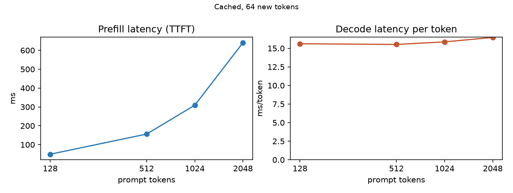
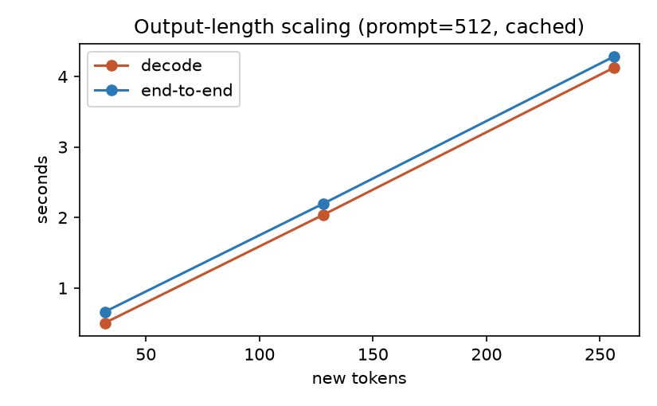
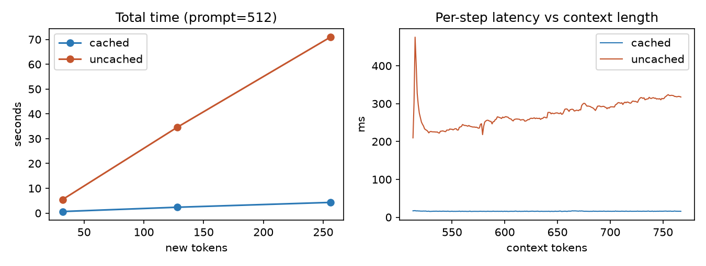

# Autoregressive inference from scratch

A hand-written greedy decoding loop for **Qwen2.5-0.5B-Instruct** (PyTorch + Hugging Face Transformers), with and without a KV cache, plus three timing experiments.

> **Hardware caveat.** All numbers below were measured on an **Apple M4 (16 GB), MPS backend, fp16**, with torch 2.15 and transformers 5.23. There was no NVIDIA GPU. The code selects cuda > mps > cpu automatically and uses `torch.cuda.synchronize` / `max_memory_allocated` on CUDA, so the same scripts run unchanged on a CUDA box. The *shapes* of the curves should carry over, but absolute numbers and the exact compute-bound/memory-bound split will not.

## Files

| File | Role |
|---|---|
| `generate.py` | `generate_uncached` / `generate_cached` greedy loops, and a CLI demo |
| `device.py` | device pick, `sync()`, `MemoryTracker` (CUDA / MPS / CPU) |
| `model_io.py`, `prompts.py`, `bench.py` | model loading, exact-length synthetic prompts, warmup + median harness |
| `run_experiments.py` | Experiments A, B, C, which write `results/*.json` and `*.csv` |
| `inspect_attention.py` | prints real tensor shapes inside one attention layer |
| `plot_results.py` | makes the PNGs in `results/` |
| `tests/` | pytest suite (37 tests, 81% line coverage of the core modules; the misses are CLI entry points and CUDA/MPS-only branches) |

```bash
uv venv --python 3.12 .venv && uv pip install --python .venv/bin/python -r requirements.txt
.venv/bin/python generate.py --mode cached          # or --mode uncached
.venv/bin/python run_experiments.py --exp all       # writes results/
.venv/bin/python plot_results.py && .venv/bin/python -m pytest tests -q
```

## 1. The inference pipeline

```
text ─tokenizer─▶ ids [1,T] ─embed─▶ [1,T,896] ─▶ 24 × (RMSNorm → attention → +res → RMSNorm → MLP → +res)
     ─final norm─▶ [1,T,896] ─lm_head─▶ logits [1,T,151936] ─take last position─▶ argmax ─▶ next id
```

`generate.py` implements the loop explicitly:

1. Tokenize the chat-templated prompt into `input_ids`.
2. Forward pass, then take `logits[:, -1, :]`, the distribution over the *next* token.
3. Greedy: `argmax`.
4. Append the token and repeat until `<|im_end|>` / `<|endoftext|>` or `max_new_tokens`.
5. `tokenizer.decode` the generated ids.

**Uncached:** every step feeds the entire sequence so far, so step *i* costs O(prompt + i) and the whole generation costs O(n²).

**Cached:** the first call (*prefill*) processes the whole prompt and returns `past_key_values`. Every later call (*decode*) feeds only the one new token plus the cache, so each step computes projections for 1 token and attends over the stored K/V.

Both loops call the model with `logits_to_keep=1`. Without it the uncached path would also pay for an lm_head over every position (151,936-wide), which is a separate inefficiency. With it, **KV caching is the only difference between the two modes.** The suite checks that both produce identical tokens, and that they match `model.generate(do_sample=False)`.

## 2. Tensor shapes in one attention layer

Config: hidden = 896, 14 query heads, **2 KV heads** (grouped-query attention), head_dim = 64, 24 layers. Shapes below were captured with `inspect_attention.py` (layer 0, B=1, T=10 prompt tokens):

| Step | Prefill (T=10) | Decode (1 new token, 10 cached) |
|---|---|---|
| input hidden_states | `[1, 10, 896]` | `[1, 1, 896]` |
| `q_proj` → Q | `[1, 10, 896]` → view `[1, 14, 10, 64]` | `[1, 1, 896]` → `[1, 14, 1, 64]` |
| `k_proj` → K | `[1, 10, 128]` → `[1, 2, 10, 64]` | `[1, 1, 128]` → `[1, 2, 1, 64]` |
| `v_proj` → V | `[1, 10, 128]` → `[1, 2, 10, 64]` | `[1, 1, 128]` → `[1, 2, 1, 64]` |
| **KV cache after the step** (K and V each) | `[1, 2, 10, 64]` | `[1, 2, 11, 64]` (**grows by 1**) |
| scores = Q·Kᵀ/√64 (K broadcast 7× across the 14 query heads) | `[1, 14, 10, 10]` (causal mask) | `[1, 14, 1, 11]` |
| softmax(scores)·V | `[1, 14, 10, 64]` | `[1, 14, 1, 64]` |
| merge heads → `o_proj` | `[1, 10, 896]` | `[1, 1, 896]` |
| logits | `[1, 1, 151936]` with `logits_to_keep=1` (`[1, 10, 151936]` without) | `[1, 1, 151936]` |

The Q, K and V head reshapes and the score/softmax shapes are the standard Qwen2 attention computation. The `q_proj`/`k_proj`/`v_proj`/`o_proj` outputs and the cache shapes are the values `inspect_attention.py` printed from the real model.

**KV cache size:** 2 (K,V) × 24 layers × 2 KV heads × 64 × 2 bytes (fp16) = **12,288 B ≈ 12 KB per token**. A 2,048-token context costs about 24 MB, which is tiny next to the ~1 GB of weights. GQA is why: with 14 KV heads it would be 7× larger.

## 3. Prefill vs decode (Experiments A and B)

Method: 3 warmup + 5 timed runs, median reported. Each timed step is bracketed by `sync(device)` and ends with `.item()` (a host sync), so the timer measures execution, not asynchronous launch. Prompts are synthetic with exact token length, and EOS is suppressed so output length is exact. **Prefill** = first forward + first token (TTFT). **Decode ms/token** = mean of the remaining n−1 steps.

### Experiment A: prompt-length scaling (64 new tokens, cached)

| Prompt tokens | Prefill / TTFT (ms) | Prefill tok/s | Decode (ms/token) | Total (s) |
|---:|---:|---:|---:|---:|
| 128 | 49.3 | 2,599 | 15.6 | 1.03 |
| 512 | 156.0 | 3,282 | 15.5 | 1.13 |
| 1,024 | 309.1 | 3,313 | 15.9 | 1.31 |
| 2,048 | 640.7 | 3,197 | 16.5 | 1.68 |



### Experiment B: output-length scaling (prompt = 512, cached)

| New tokens | Prefill (ms) | Decode total (s) | Decode (ms/token) | End-to-end (s) |
|---:|---:|---:|---:|---:|
| 32 | 157.1 | 0.51 | 16.3 | 0.66 |
| 128 | 158.5 | 2.04 | 16.0 | 2.19 |
| 256 | 158.5 | 4.12 | 16.2 | 4.28 |



**Reading the tables**

- Prefill time grows roughly **linearly with prompt length** (about 3.2–3.3k tokens/s once the prompt is ≥ 512; the 128-token prompt is too small to saturate the GPU). At these sizes the attention term is small next to the matmuls, so no clear quadratic term shows up. TTFT therefore scales with prompt length.
- Decode cost per token is **nearly flat, about 15.5–16.5 ms**, across prompts of 128 → 2,048 tokens and outputs of 32 → 256 tokens. There is a ~1 ms rise at a 2,048-token prompt, which I did not investigate further. Decode time is therefore linear in the number of generated tokens.
- End-to-end ≈ TTFT + (n−1) × per-token decode. Prompt length moves the first term, and output length moves the second.
- At 512 prompt tokens, a single decode step (16 ms) is 10× cheaper than prefill (156 ms) but processes 1 token instead of 512, so per *token* decode is ~50× less efficient (62 tok/s vs 3,282 tok/s).

## 4. Cached vs uncached (Experiment C)

Prompt = 512 tokens, same model, same prompts, same greedy procedure, EOS suppressed. Cached and uncached runs are **interleaved** (cached, uncached, cached, ...) with a 10 s cooldown between configurations, so slow drift does not systematically favour one mode.

| New tokens | Mode | Total (s) | Mean decode step (ms) | Tokens/s | Speedup | Tokens identical? |
|---:|---|---:|---:|---:|---:|:--:|
| 32 | cached | 0.65 | 15.6 | 49.6 | **8.5×** | yes |
| 32 | uncached | 5.46 | 171.0 | 5.9 | | |
| 128 | cached | 2.37 | 17.0 | 54.1 | **14.6×** | yes |
| 128 | uncached | 34.62 | 271.2 | 3.7 | | |
| 256 | cached | 4.31 | 16.0 | 59.4 | **16.5×** | yes |
| 256 | uncached | 70.93 | 277.5 | 3.6 | | |



- Cached per-step latency stays flat (about 16 ms). **Uncached per-step latency climbs with context length**: for the 256-token run the median step is ~227 ms near 520 tokens of context and ~318 ms near 770 (right panel). Each step re-runs the whole sequence, which is the O(n²) total. "Mean decode step" for uncached depends on how long the output is, so it is not comparable to the cached figure; use total time and the per-step curve.
- An uncached step costs about as much as a prefill of the same length, because it *is* one. Compare ~227 ms per step with the 156 ms prefill of a 512-token prompt.
- The speedup **keeps growing with output length** (8.5× → 14.6× → 16.5×). Prefill is a fixed cost shared by both modes, so short outputs hide the gain, and the uncached step also gets slower as the sequence grows. At 256 tokens the ratio of mean step costs is ~17×.
- Generated tokens were **identical across every run of both modes** in all three configurations, even in fp16.

**Drift caveat.** The harness compares the prefill of the two modes, which is the same computation. The check flagged two of the three configurations (128 tokens: 30% apart; 256 tokens: 20% apart). In both, it is the *cached* prefill that is slow (median 242 / 225 ms against 160 ms elsewhere, with spikes up to ~380 ms). That is consistent with the cached run following a 30–70 s uncached run while the chip is hot. This inflates the cached total, so the speedups there are, if anything, **understated**: the 128-token cached total of 2.37 s is ~8% above the 2.19 s Experiment B measured for the same workload. I did not isolate the cause (thermal throttling is my hypothesis, not a measurement).

### Memory

`MemoryTracker` samples live tensor bytes (`torch.mps.current_allocated_memory()`) after every step and reports the peak above the pre-run baseline. The baseline (~960 MB) is the fp16 weights.

| Config | Peak above baseline | Analytic KV cache |
|---|---:|---:|
| cached, 512 prompt + 32 new | 6.7 MB | 6.4 MB |
| cached, 512 prompt + 128 new | 7.8 MB | 7.5 MB |
| cached, 512 prompt + 256 new | 9.3 MB | 9.0 MB |
| uncached (any of the above) | 0.3 MB | 0 |

- The cached overhead tracks the analytic size, `2 × layers × kv_heads × head_dim × dtype_bytes × tokens` = 12,288 B/token, to within ~0.3 MB (that remainder is the per-step logits and similar small buffers). Experiment A agrees: 2.5 / 7.0 / 13.0 / 25.0 MB for 128 / 512 / 1,024 / 2,048-token prompts, each ~0.3 MB above the analytic KV for prompt + 63 tokens.
- So the cache costs memory that **grows linearly with context** (a few MB here, 12 KB/token), against a ~960 MB fixed weight cost, in exchange for a ~15× speedup.
- **Limits of this measurement.** The peak is taken from samples *after* each step, so transient activations *inside* a forward pass are not seen. That is why the uncached row reads near zero: it keeps no persistent cache, but it does allocate full-sequence activations during each step. MPS also has no peak-reset counter. A true peak-GPU-memory comparison needs CUDA, where `torch.cuda.reset_peak_memory_stats` / `max_memory_allocated` capture in-forward peaks. I did not run that.

## 5. Bottlenecks

- **Prefill is compute-bound.** Processing 512 tokens at once turns each linear layer into a large matrix-matrix multiply, and it runs at ~3.3k tok/s. Doubling the prompt roughly doubles the time, so TTFT is set by prompt length.
- **Decode is not compute-bound.** A step does ~1/512 of prefill's FLOPs yet takes ~10% of its wall time. Each step has to stream all ~0.99 GB of fp16 weights (plus the KV cache) from memory to produce one token, and a matrix-vector product has almost no arithmetic per byte. Rough floor: 0.99 GB ÷ M4's ~120 GB/s ≈ 8 ms, versus the observed ~16 ms. I did not profile the other ~8 ms, but candidates are per-layer kernel-launch and framework overhead on a 24-layer model at batch size 1. This is why decode is "slower than expected" for how little it computes.
- **Decode latency is nearly independent of prompt length here** because the KV cache (≤ 25 MB) is dwarfed by the weights being read each step. At longer contexts or larger batches the cache read would start to matter.
- **Without a cache, every decode step is a mini prefill**, which makes total cost quadratic. This produced a 16.5× slowdown at 256 tokens, and the gap keeps widening with output length.
- **Batching is the lever for decode efficiency.** Reading the weights once for B sequences amortises the same memory traffic. That is covered from [`02-kv-cache-memory`](../02-kv-cache-memory/) onward and was not measured here.

## 6. Knowledge checkpoint (answer without notes)

1. What happens when an LLM generates a token?

   _Your answer:_

2. Why can decode be slower than expected despite doing less computation than prefill?

   _Your answer:_

3. What exactly is stored in a KV cache?

   _Your answer:_

4. Why does caching improve autoregressive inference?

   _Your answer:_

5. How do prompt length and output length affect TTFT and total latency?

   _Your answer:_

## Limitations

- Single device (M4/MPS), one full run of the suite, 5 repeats per point. Only the 128/512/1,024/2,048 prompt lengths and 32/128/256 output lengths were tested. Differences of a few percent are within noise.
- Two of the three Experiment C configurations tripped the drift check (see section 4). The speedups there are likely conservative, but not precisely quantified.
- Batch size 1 only.
- Peak memory is sampled after each step, so in-forward transients are missed. In particular the uncached mode's activation memory is under-reported. True peaks need CUDA.
- An earlier run of this suite used `torch.mps.driver_allocated_memory()` for memory. That counter is a grow-only pool and reported ~1,057 MB for every configuration (and a spurious +1 GB at a 2,048-token prompt), so it was replaced. Its results are kept in `results/previous_run/` for reference only and are not used above.
