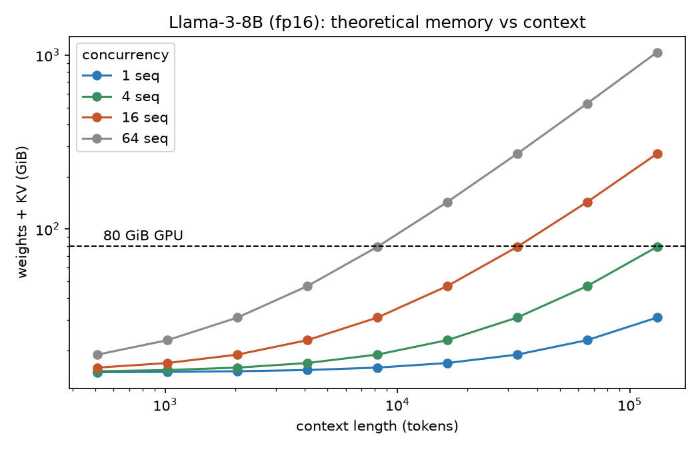
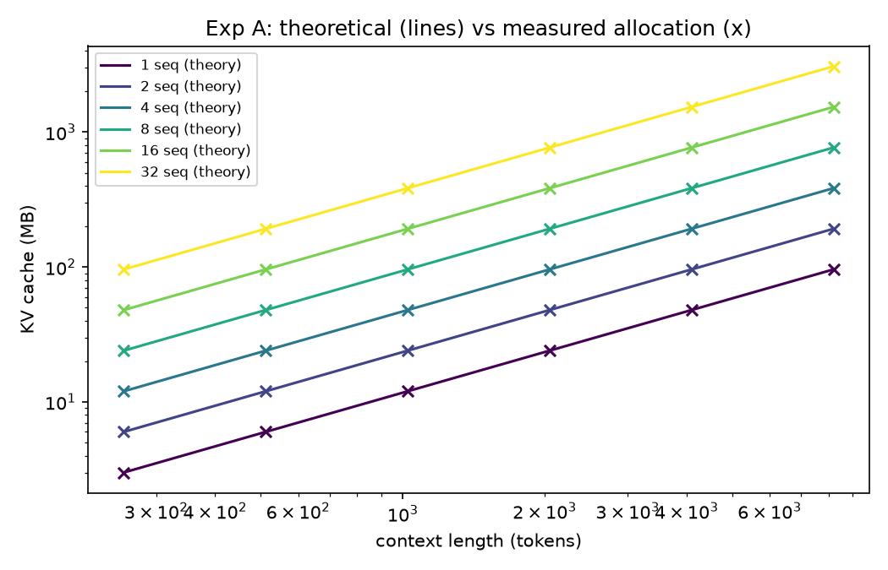
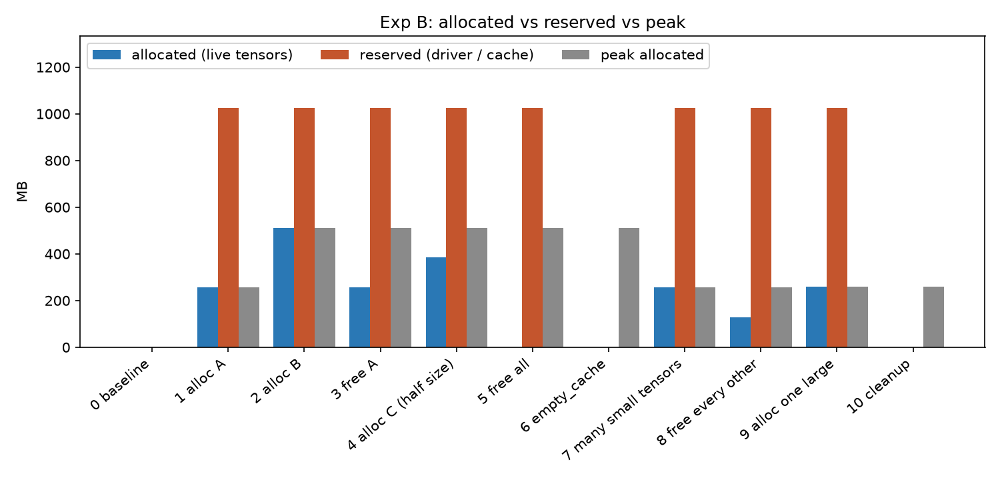
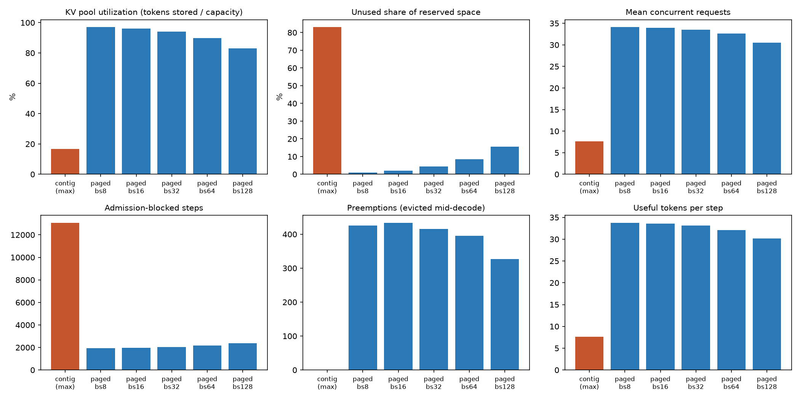

# Day 2: GPU memory — calculator, paged KV allocator, experiments

> **Hardware caveat.** This was built on an Apple M4 (16 GB unified memory). There is **no CUDA GPU**, so
> `torch.cuda.memory_allocated / memory_reserved / max_memory_allocated` were never executed. `memory_probe.py`
> maps them to the closest MPS counters (`torch.mps.current_allocated_memory` → allocated,
> `driver_allocated_memory` → reserved) and samples the peak itself because MPS has no peak counter. The CUDA
> branch is written but **untested on real hardware**. Experiment C is pure simulation and is hardware-independent.
> The conceptual points hold on CUDA; the exact reserved-memory numbers in Exp B are MPS-specific.

## Files

| File | Purpose |
|---|---|
| `memory_calculator.py` | Theoretical weights / KV / total memory, growth with context, max concurrency, GQA savings. CLI. |
| `paged_allocator.py` | `PagedKVAllocator` (fixed-size blocks, block tables, free list) and `ContiguousAllocator` (reserve-max baseline). Metadata only; no attention kernel. |
| `kv_simulation.py` | Seeded serving simulation (arrivals, admission, decode, preemption) used by Exp C. |
| `memory_probe.py` | Allocated / reserved / peak counters for CUDA, MPS and CPU. |
| `run_experiments.py` | Experiments A, B, C → `results/exp_*.json` and `.csv`. |
| `plot_results.py` | PNGs in `results/`. |
| `tests/` | 85 tests; 98% line coverage of the modules (99% counting the test files). |

```bash
uv venv --python 3.12 .venv && uv pip install --python .venv/bin/python -r requirements.txt
.venv/bin/python -m pytest tests -q --cov=.
.venv/bin/python memory_calculator.py --preset llama3-8b --context 8192 --seqs 16 --gpu-gb 80
.venv/bin/python run_experiments.py --exp all        # add --smoke for a fast check, --device cpu|mps|cuda
.venv/bin/python plot_results.py
```

(`kv_simulation.py` was not in the original plan; it was split out of `run_experiments.py` to keep files focused.)

## 1. Where GPU memory goes

For one serving process, memory is the sum of:

| Component | Size | Grows with |
|---|---|---|
| **Weights** | `params × bytes/param` | model size and precision only |
| **KV cache** | `2 × layers × kv_heads × head_dim × bytes × tokens` | context length × concurrent sequences |
| Activations | transient per-forward buffers | batch × tokens in flight (small in decode, larger in prefill) |
| Runtime overhead | CUDA context, kernels workspace, allocator slack | roughly constant, plus fragmentation |

The calculator models the first two exactly and treats the rest as an `--overhead` fraction (default 10%). It does
**not** estimate activations; that is a deliberate gap.

Worked example, Llama-3-8B (32 layers, 8 KV heads, head_dim 128, fp16), on an 80 GiB GPU:

| Deployment | Weights | KV cache | Total | Verdict |
|---|---|---|---|---|
| 8k context × 16 seqs, fp16 KV | 14.96 GiB | 16.00 GiB | 30.96 GiB | fits; up to **57** seqs at 8k |
| 32k context × 16 seqs, fp16 KV | 14.96 GiB | 64.00 GiB | 78.96 GiB | **does not fit** with 10% overhead; max **14** seqs |
| 8k context × 16 seqs, **fp8 KV** | 14.96 GiB | 8.00 GiB | 22.96 GiB | fits; up to **114** seqs |
| Llama-3-70B, 8k × 8 seqs | 131.50 GiB | 20.00 GiB | 151.50 GiB | weights alone exceed 80 GiB: 0 seqs |

KV per token is 128 KiB for Llama-3-8B and 12 KiB for Qwen2.5-0.5B (matches Day 1's `kv_bytes_per_token`).



## 2. Why KV-cache usage grows with context

Attention at each new token needs the keys and values of *every* earlier token, in every layer. Recomputing them
is what Day 1's uncached loop did (quadratic work). Caching them trades compute for memory: one K and one V vector
per token per layer per KV head. Memory is therefore **linear in tokens** (`kv_bytes_per_token × tokens`), and
linear again in the number of sequences. The weights, by contrast, are paid once and shared by all sequences.
At long context or high concurrency the KV cache overtakes the weights (above: 16 GiB KV vs 15 GiB weights at
only 8k × 16).

## 3. Experiment A — memory scaling

Qwen2.5-0.5B shape (24 layers, 2 KV heads, head_dim 64, fp16), one K and one V tensor per layer, context
256–8192 × 1–32 sequences (36 points, largest 3 GiB). `measured` is the change in live-tensor bytes.



**Result:** measured / theoretical = **1.0000 at all 36 points** (e.g. 8192 × 32: 3072.0 MB measured vs 3072.0 MB
theory). The formula is exact for the *data*. It is exactly 1 because every tensor size here (smallest: 64 KiB) is
a multiple of the allocator's size granularity, so `allocated` counts precisely the requested bytes. Odd-sized tensors
would be rounded up. This says nothing about `reserved`, which (Exp B) can be far larger. Doubling either axis doubles
the bytes, as the formulas predict. The 1.0000 is an **MPS** result: on CPU the probe reads process RSS, which is
noisy (malloc arenas may keep freed pages, so later points can read below theory).

## 4. Experiment B — allocated vs reserved vs peak (MPS)

256 MB tensors, scripted sequence (`results/exp_b.csv`):

| Stage | allocated MB | reserved MB | peak MB |
|---|---|---|---|
| 0 baseline | 0 | 0.5 | 0 |
| 1 alloc A (256 MB) | 256 | **1024** | 256 |
| 2 alloc B (256 MB) | 512 | 1024 | 512 |
| 3 free A | 256 | 1024 | 512 |
| 4 alloc C (128 MB) | 384 | 1024 | 512 |
| 5 free all | **0** | **1024** | 512 |
| 6 `empty_cache()` | 0 | **0.5** | 512 |
| 7 16 small tensors | 256 | 1024 | 256 |
| 8 free every other | 128 | 1024 | 256 |
| 9 alloc one large (128 MB + 1 B; counted as ~132 MB) | 260 | 1024 | 260 |
| 10 cleanup | 0 | 0.5 | 260 |



What it shows:
- **allocated** tracks live tensors exactly and falls the instant a tensor is freed (stage 3, 5).
- **reserved** is memory the allocator holds from the driver. It stays high after tensors are freed (stage 5:
  0 live bytes, 1024 MB held) so later allocations skip the slow driver call, and only drops on `empty_cache()` (stage 6).
- **peak** is the high-water mark of *allocated* since the last reset (512 MB at stage 2 survives to stage 6).
  Provisioning has to cover the peak, not the current value.

What it does **not** show: the first 256 MB request made the Metal driver reserve **1024 MB**, a coarse heap
granularity. Hence stage 4 does not prove block reuse (reserved was already 1024), and in stage 9 the large
allocation fit without growing reserved, so I did **not** reproduce CUDA-style fragmentation where freed holes cannot
satisfy one big request. Peak here is sampled, not hardware-tracked. On CUDA I would expect stage 9 to grow `reserved`.

## 5. Why continuous, variable-length sequences complicate allocation

A request's final length is unknown at admission: output length depends on when the model emits EOS. Its KV grows by
one token per step, while requests arrive and finish at different times. A contiguous buffer must be sized upfront.
Reserving the **maximum** length wastes most of it; reserving the **expected** length risks running out mid-decode,
and growing in place is impossible when neighbours occupy the next addresses (copying is expensive). Freed buffers of
mixed sizes leave holes (external fragmentation) that no new, larger request fits into.

## 6. Block-based (paged) management

`PagedKVAllocator` splits the pool into fixed-size blocks of `block_size` tokens. Each request has a block table
(ordered block ids + token count):
- **allocate** takes `ceil(prompt/block_size)` blocks, all-or-nothing;
- **extend** takes one new block only when the last block is full;
- **free** returns the blocks to a free list on completion;
- exhaustion raises `InsufficientBlocksError` and increments a failure counter.

Any free block can serve any request, so there is no external fragmentation and no need to know the final length.
Waste is bounded to **less than one block per request** (internal fragmentation in the last block). The cost is an
indirection: attention must gather K/V through the block table (the kernel work this project deliberately skips).

## 7. Experiment C — paged vs reserve-max-upfront

Same seeded workload against the same pool (16,384 token slots). 600 requests, lognormal prompt/output lengths
(mean total 373 tokens, median 293, max 2,048), 0.5 arrivals/step. The system is deliberately **overloaded**, so
queues form for every policy. `contiguous-max` reserves 2,048 slots per request (pool fits 8). Full-size output is
`results/exp_c.csv`.

| Allocator | Mean concurrent | Pool utilization | Unused share of reserved | Admission-blocked steps | Preemptions | Tokens/step | Wait to first admission (steps) | Arrival→done latency (steps) |
|---|---|---|---|---|---|---|---|---|
| contiguous-max | 7.6 | 16.8% | **83.1%** | 13,076 | 0 | 7.66 | 5,587 | 5,766 |
| paged bs=8 | 34.1 | **97.1%** | **1.0%** | 1,951 | 426 | 33.78 | 339 | 526 |
| paged bs=16 | 33.9 | 96.0% | 2.1% | 1,979 | 434 | 33.55 | 350 | 537 |
| paged bs=32 | 33.5 | 94.0% | 4.3% | 2,035 | 416 | 33.11 | 373 | 560 |
| paged bs=64 | 32.6 | 89.8% | 8.4% | 2,169 | 395 | 32.07 | 426 | 614 |
| paged bs=128 | 30.5 | 83.1% | 15.5% | 2,377 | 327 | 30.12 | 518 | 704 |



Metric definitions: *utilization* = tokens stored / pool capacity; *unused share of reserved* = reserved slots
holding no token yet / reserved slots (internal fragmentation); both averaged over steps where the wait queue is
non-empty, i.e. the pool is contended. *Admission-blocked steps* counts steps where the head-of-line request could not
be allocated. *Preemptions* are running requests evicted mid-decode because no block was free (youngest evicted first,
then restarted from scratch). *Wait to first admission* ignores time spent re-queued after a preemption;
*arrival→done latency* includes it, and is the fairer latency comparison for paged.

Reading it:
- Contiguous-max keeps **83% of what it reserves empty**, so only 8 requests fit and 4.4× less work gets done per step.
- Paged is nearly full (83–97% of the pool holds real tokens while contended). Internal fragmentation grows with
  block size, from 1% at 8 tokens to 15.5% at 128, a direct fragmentation-vs-metadata tradeoff (small blocks mean
  bigger block tables and finer gathers).
- Paging is not free of failure: because it admits optimistically, the pool genuinely runs out mid-decode and
  **~400 preemptions** occur. The work they discard is already netted out of tokens/step. Contiguous never preempts
  but pays by blocking admissions for 13k steps. Preempt-youngest matters: my first version evicted whichever request
  failed and **livelocked** (155k preemptions, 1 of 4 requests finished on a tiny pool).

## 8. Allocation overhead vs true data storage

- **True data**: bytes that hold real K/V values for tokens that exist, i.e. what the calculator and Exp A compute.
- **Allocation overhead**: bytes set aside but holding no live data — over-reservation (83% in contiguous-max),
  last-block slack (paged), the caching allocator's reserved-but-free pool (Exp B), and fragmentation.
Exp A shows data = theory exactly. Exp B and C show how far *footprint* can diverge from data. Capacity planning needs
the footprint, and a good allocator is one whose footprint stays close to the data.

## When KV-cache capacity is exhausted

The allocator raises (or returns "no") and the engine must pick a policy. Options: **queue** new requests until blocks
free up (Exp C's contiguous behaviour, and paged's admission blocking); **preempt** a running request and either
recompute later (what the simulation does) or swap its blocks to CPU memory; or **reject** the request. All of them
trade latency or wasted work for staying within memory; none gives you more capacity. The remedy is more capacity:
smaller KV dtype (fp8 above doubles concurrency), GQA, a shorter max context, or more GPUs.

## Knowledge checkpoint

**1. Why does a model consume more GPU memory when concurrency increases?**
Weights are shared, but every in-flight sequence has its own KV cache. Memory is
`weights + seqs × context × kv_bytes_per_token` (+ activations), so it grows linearly with concurrency. Exp A: doubling
the sequences doubled the KV bytes at every context length.

**2. What is the relationship between HBM bandwidth and decode speed?**
Decode generates one token per step and, at small batch, does little arithmetic per byte. Each step must stream all
the weights (and each sequence's KV cache) from HBM to the compute units, so it is **memory-bandwidth-bound**:
`time/token ≳ (weight bytes + KV bytes read) / bandwidth`. For Llama-3-8B in fp16 (~16 GB) on an H100 (~3.35 TB/s) that
is a ~4.8 ms floor, about 200 tokens/s for a single stream. This is back-of-envelope arithmetic; I did not measure
it, and Day 1's M4 numbers are on a different memory system. Batching amortises the weight read across sequences;
long contexts add KV traffic that does not amortise.

**3. How does Grouped-Query Attention reduce KV-cache memory?**
Several query heads share one K/V head, so only `num_kv_heads` (not `num_query_heads`) K/V vectors are cached per token. The cache shrinks by
`query_heads / kv_heads`: 4× for Llama-3-8B (32/8), 7× for Qwen2.5-0.5B (14/2, the figure Day 1 reported), 8× for
Llama-3-70B (64/8). Quality loss is small; it is a standard way to buy concurrency.

**4. Why do reserved GPU memory and allocated GPU memory differ?**
Allocated is the bytes in live tensors. Reserved is what PyTorch's caching allocator has obtained from the driver. It keeps freed blocks
for reuse, because driver allocation is slow and synchronising. Exp B: after freeing everything, allocated = 0 but
reserved = 1024 MB until `empty_cache()`. Reserved can also exceed allocated because of rounding and fragmentation.
External tools such as `nvidia-smi` report something close to reserved, not allocated.

**5. How does paged KV-cache allocation differ from contiguous allocation?**
Contiguous gives each request one address range sized upfront (usually the maximum), so most of it sits unused (83% in
Exp C) and freed ranges fragment. Paged hands out fixed-size blocks on demand through a per-request block table, so
waste is under one block per request (1–16% in Exp C depending on block size), freed blocks are reusable by anyone,
and no length prediction is needed. The price is the block-table indirection in the attention kernel.

**Completion criterion.** Using Section 1's calculator: Llama-3-8B, fp16, 32k context × 16 seqs needs 78.96 GiB
(14.96 weights + 64 KV) and does not fit on an 80 GiB GPU with 10% overhead; only 14 sequences fit. At exhaustion, the
engine queues, preempts (recompute or swap) or rejects (see above); fp8 KV or fewer sequences get it under budget.

## Limitations

- **No CUDA.** The CUDA probe branch is untested. Exp B's reserved numbers reflect Metal heap granularity (1 GiB), not
  CUDA's caching allocator, and CUDA-style fragmentation was not reproduced. MPS peak is sampled.
- **Exp A** uses large tensors, where rounding overhead is invisible; it validates the arithmetic, not allocator slack
  at small sizes.
- **Exp C is a model.** One workload and seed (no variance across seeds, though `--seed` allows it), time measured in
  steps, not seconds, and an overloaded arrival rate chosen to stress the allocators. The contiguous baseline is
  *generous*: it ignores external fragmentation, so real contiguous allocators would look worse. The paged side
  ignores block-table lookup cost and has no prefix sharing or swapping. Recompute preemption is the only recovery policy.
- **No attention kernel and no activations model.** Totals are weights + KV (+ a flat overhead fraction); real
  deployments also need activation and workspace memory, especially during prefill.
- The HBM-bandwidth estimate in checkpoint Q2 is arithmetic, not a measurement.
- **CPU runs** of Exp A/B read process RSS for both "allocated" and "reserved": the numbers are noisy, lag frees, and
  the Exp B plot omits the reserved bars there. All published figures are from MPS.
- **Recompute is free in the simulation.** A preempted request restarts with no prefill cost, so preemption is cheaper
  than on a real server, which flatters paged's throughput and latency somewhat.
- **Quantized sizes are idealised.** `int4`/`fp8` use 0.5/1 byte per element and ignore scales, zero-points and
  group-quantization metadata (typically a further ~0.06–0.125 B/param for int4).
- The simulation rejects configurations where a single request cannot fit in the pool (it would otherwise spin forever).
