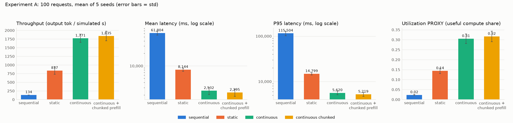
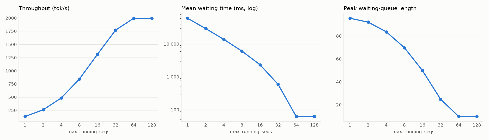
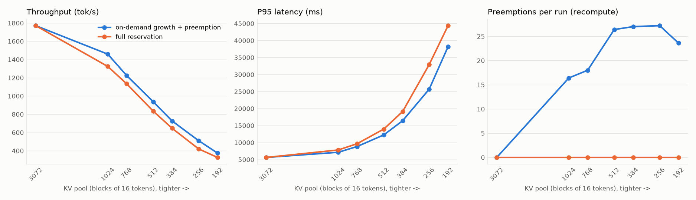
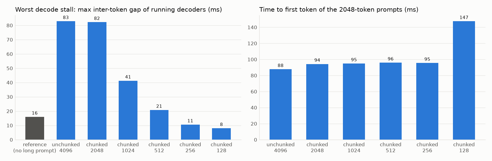
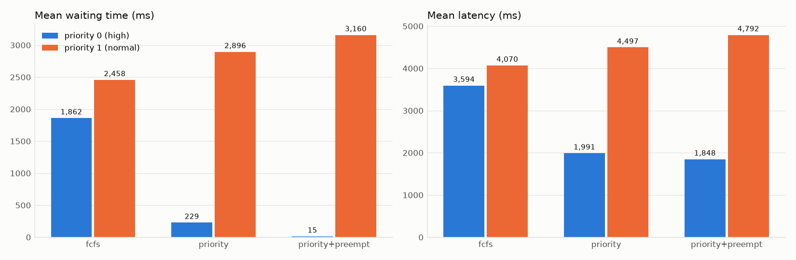
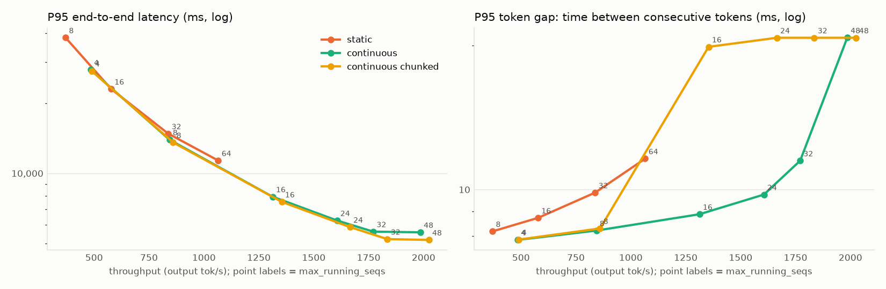
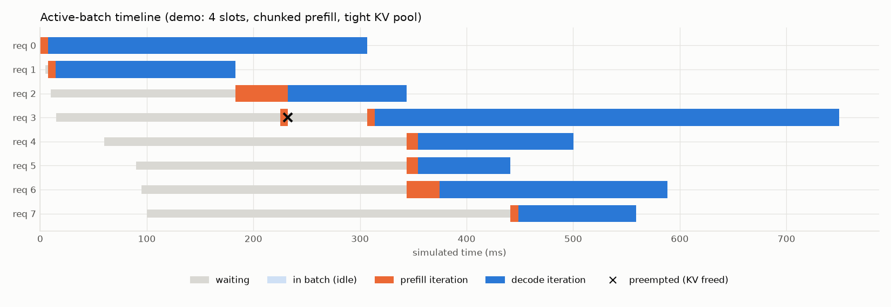

# Continuous-batching scheduler simulator

> **Simulation caveat.** Everything here is a discrete-event simulation driven by an analytic cost
> model ([cost_model.py](cost_model.py)). Times are *simulated* milliseconds, not measurements from a
> GPU; the model constants are illustrative. "Utilization" is a **proxy** (useful compute time over
> wall time), not hardware GPU utilization. Trust the *relative* behaviour and mechanisms, not the
> absolute numbers. The design and its simplifications are in [DESIGN.md](DESIGN.md).

## Files

| File | Purpose |
|---|---|
| [request.py](request.py) | `Request` (spec fields plus priority, progress counters, timestamps) |
| [cost_model.py](cost_model.py) | documented roofline-style per-iteration time model |
| [kv_blocks.py](kv_blocks.py) | simulated paged-KV block accounting |
| [scheduler.py](scheduler.py) | `ContinuousScheduler` (FCFS / priority / chunked prefill / preemption), `StaticScheduler` |
| [simulator.py](simulator.py) | event loop, iteration records, event log |
| [metrics.py](metrics.py) | throughput, latency percentiles, TTFT, token gaps, utilization proxy |
| [workload.py](workload.py) | seeded 100-request mix and the long-prompt scenario |
| [strategies.py](strategies.py) | the four compared strategies |
| [timeline.py](timeline.py) | ASCII and Gantt timeline of the active batch |
| [run_experiments.py](run_experiments.py) | experiments A to F and T |
| [plot_results.py](plot_results.py) | figures |
| [DESIGN.md](DESIGN.md) | short design document with a timeline |
| `tests/` | 95 tests, 99% line coverage (includes a randomized invariant test over all scheduler modes) |

```bash
cd 03-batching-simulator
uv venv --python 3.12 .venv && uv pip install --python .venv/bin/python -r requirements.txt
.venv/bin/python -m pytest tests -q --cov=.
.venv/bin/python run_experiments.py --exp all [--smoke] [--out DIR] [--seed N]   # ~5 s
.venv/bin/python plot_results.py
```

The full run writes `results/exp_{a..f}.{json,csv}` (one row per seed), `exp_*_summary.*` (mean and
std over 5 seeds), `exp_f_pairs.*`, `timeline.txt` and `run_log.txt`. Every number below comes from
that run (seeds 0 to 4) unless it says otherwise.

## Setup

**Cost model** (`iter_ms = 0.3 + max(0.04 * tokens, 7.0 + 0.0001 * decode_context)`): decode is
memory-bound, so a bigger decode batch is nearly free; prefill is compute-bound, so a 2048-token
prompt costs ~82 ms against ~7.5 ms for a decode step.

**Workload** (100 requests, seeded; see [workload.py](workload.py)): 70% short prompts (32 to 256
tokens) and 30% long (1024 to 2048); 60% short outputs (16 to 64) and 40% long (200 to 512); 70
requests arrive as a Poisson process (mean gap 60 ms) and 30 arrive in a 300 ms burst mid-way; 20%
are priority 0, the rest priority 1. This **overloads** every strategy (the engine is busy 100% of
the time), which is the regime where scheduling differences show. Defaults: 32 batch slots, 3072 KV
blocks of 16 tokens, token budget 4096 (512 when chunked).

**Metrics.** Throughput = output tokens per simulated second over the makespan. Latency =
finish minus arrival (includes queueing). TTFT = first token minus arrival. `worst_itl_p95` = 95th
percentile, across requests, of each request's *single worst* gap between consecutive tokens (a
per-request stall measure; in `results/`). `p95_token_gap` / `max_token_gap` are taken over *every* inter-token
gap of every request (the per-token tail). They answer different questions and sometimes disagree
(see A and F). Utilization proxy = sum(useful tokens x 0.04 ms) / makespan; idle gaps, padded
static slots and KV recomputed after a preemption do not count as useful, and since decode is
memory-bound even a perfect decode-only schedule scores low.

## Experiment A: the four strategies

Mean over 5 seeds of the 100-request workload (latencies in simulated ms).

| Strategy | Throughput (tok/s) | Mean latency | P95 latency | Utilization proxy | Mean TTFT | P95 token gap | Worst token gap |
|---|---:|---:|---:|---:|---:|---:|---:|
| Sequential | 134 | 61,804 | 115,504 | 0.023 | 60,577 | 7.5 | 7.5 |
| Static batching (32) | 837 | 8,144 | 14,799 | 0.144 | 6,359 | 9.9 | 699 |
| Continuous batching | 1,771 | 2,532 | 5,620 | 0.305 | 627 | 11.5 | 118 |
| Continuous + chunked prefill | 1,835 | 2,295 | 5,219 | 0.316 | 519 | 20.8 | 20.8 |



* Continuous batching gives 13x the throughput of sequential and 2.1x static batching, with P95
  latency 21x and 2.6x lower. Static batching wastes 65% of its billed decode slots on finished
  sequences and cannot admit anything until the whole batch drains.
* Chunked prefill adds a modest +3.6% throughput and -9% mean latency, and **bounds the worst stall**:
  the worst token gap falls from 118 ms to 21 ms, because no iteration is longer than one budget's worth
  of tokens. It does not make the typical token faster. The per-token P95 gap is *higher* with chunking
  (20.8 vs 11.5 ms): under this backlog nearly every iteration carries a 512-token chunk (~21 ms), while
  unchunked mostly runs ~9 ms pure-decode iterations with occasional 80+ ms stalls. A smaller budget
  lowers the typical gap too (experiment D: 256 gives 11 ms), at the cost of a slower long-prompt
  prefill.
* The std across seeds (different random workloads) is about 6% of mean throughput for continuous
  batching, larger than the 3.6% gap between continuous and chunked. The comparison is paired on the same
  workload, though, and chunked prefill wins on all 5 seeds: throughput +0.7 to +5.0%, mean latency
  -7.7 to -10.8%, P95 latency -4.4 to -9.3%.

## Investigations

### B. What happens when the active batch is full? (`max_running_seqs` sweep, continuous)

| max_running_seqs | Throughput | Mean wait (ms) | Peak queue | Mean batch |
|---:|---:|---:|---:|---:|
| 1 | 134 | 60,553 | 95 | 1.0 |
| 8 | 843 | 6,059 | 70 | 7.3 |
| 16 | 1,313 | 2,338 | 50 | 12.8 |
| 32 | 1,771 | 590 | 25 | 20.5 |
| 64 | 1,995 | 62 | 9.8 | 26.3 |
| 128 | 1,995 | 62 | 9.8 | 26.3 |

New requests stop being admitted and wait: the queue grows, and time-to-first-token becomes almost
entirely queueing. Throughput scales almost linearly with batch size while slots are the limit, then
plateaus: at 64 and 128 the cap never binds (peak KV use is 71%, mean batch is only 26), so the engine
is compute- and arrival-limited and extra slots buy nothing. The remaining queue at 64+ is the burst
waiting on the per-iteration token budget.



### C. What happens when KV blocks are exhausted? (pool-size sweep, 32 slots)

| KV blocks | Mode | Throughput | P95 latency | Mean batch | Preemptions / run | Recomputed tokens / run |
|---:|---|---:|---:|---:|---:|---:|
| 3072 | either | 1,771 | 5,620 | 21 | 0 | 0 |
| 1024 | on-demand | 1,459 | 7,139 | 16 | 16 | 8,262 |
| 1024 | full reserve | 1,324 | 7,820 | 13 | 0 | 0 |
| 512 | on-demand | 937 | 12,233 | 9.0 | 26 | 14,841 |
| 512 | full reserve | 834 | 13,953 | 7.3 | 0 | 0 |
| 256 | on-demand | 511 | 25,688 | 4.3 | 27 | 13,044 |
| 256 | full reserve | 420 | 32,915 | 3.4 | 0 | 0 |

(The 768, 384 and 192 block rows are in [exp_c_summary.csv](results/exp_c_summary.csv).) A smaller
pool shrinks the concurrent batch (mean batch 21 to 4 across the sweep), so throughput falls steeply and
tail latency balloons. With on-demand growth, a decoder that cannot get its next block triggers
**preemption by recompute** of the youngest running request: its blocks are freed, it re-queues and later
re-prefills its prompt plus the tokens it had generated. In this model recompute is cheap (prefill is
compute-bound at 0.04 ms/token), so on-demand growth beats full reservation by 8 to 22% throughput
despite thousands of recomputed tokens: reservation strands blocks for output that has not been
generated yet. Caveat: the simulator knows each output length exactly, so "full reserve" is the best case; a
real engine must reserve for `max_tokens` and would do worse.



### D. A long prompt arrives during decoding (16 decoders, two 2048-token prompts, one deterministic run)

| Mode | Token budget | Worst decoder stall (ms) | Long-prompt TTFT (ms) | Throughput |
|---|---:|---:|---:|---:|
| Reference (no long prompt) | 4096 | 16 | n/a | 2,045 |
| Unchunked | 4096 | 83 | 88 | 1,957 |
| Chunked | 2048 | 82 | 94 | 1,958 |
| Chunked | 1024 | 41 | 95 | 1,967 |
| Chunked | 512 | 21 | 96 | 1,984 |
| Chunked | 256 | 11 | 95 | 2,017 |
| Chunked | 128 | 8.0 | 147 | 2,040 |

An unchunked 2048-token prefill is one ~82 ms iteration in which every decoder gets no new token, a
5x stall over the reference. The stall is bounded by the budget: it tracks `0.04 ms x budget`. The
cost is on the long prompt itself: TTFT is flat down to a 256-token budget (the chunks ride under
decode iterations nearly for free) and then jumps to 147 ms at 128, where the prompt needs 16
chunks. A 2048 budget changes nothing because the prompt fits in one chunk. (The 16 ms reference
stall comes from the 16 decoders' own staggered prompts.)



### E. What changes with priorities? (16 slots, 5 seeds)

| Policy | Class 0 wait | Class 0 mean latency | Class 1 wait | Class 1 mean latency | Throughput | Recomputed tokens |
|---|---:|---:|---:|---:|---:|---:|
| FCFS | 1,862 | 3,594 | 2,458 | 4,070 | 1,313 | 0 |
| Priority | 229 | 1,991 | 2,896 | 4,497 | 1,331 | 0 |
| Priority + preempt | 15 | 1,848 | 3,160 | 4,792 | 1,300 | 8,119 |

Priority ordering moves waiting time from class 0 to class 1: class 0 wait falls 8x, class 1 mean
latency rises 11%. Adding preemption of lower-priority runners nearly eliminates class 0 waiting (15 ms) but
pays for it: 13 preemptions per run in class 1, 8k recomputed tokens, 2.3% lower throughput than plain
priority, and class 1 gets a further 7% slower. There is no aging, so class 1 would starve under a
sustained high-priority load; here class 0 is only 22% of requests, so the penalty stays moderate.



### F. Can throughput improve while P95 latency gets worse?

**Yes for the per-token tail; not shown for end-to-end P95 in this sweep.** Mean change between
consecutive sizes of `max_running_seqs` (5 seeds; sizes stop at 48 because above that the workload is
arrival-bound and throughput no longer moves). The last two columns count seeds where throughput rose by
at least 2% *and* the tail got worse by at least 2%:

| Family | Size change | Throughput | P95 e2e latency | P95 token gap | seeds: e2e worse | seeds: token gap worse |
|---|---|---:|---:|---:|---:|---:|
| Continuous | 4 to 8 | +74% | -50% | +4.6% | 0/5 | 5/5 |
| Continuous | 16 to 24 | +22% | -21% | +9.9% | 0/5 | 5/5 |
| Continuous | 24 to 32 | +10% | -10% | +17% | 0/5 | 5/5 |
| Continuous | 32 to 48 | +12% | -0.6% | +67% | 1/5 | 4/5 |
| Continuous + chunked | 16 to 24 | +23% | -22% | +5.4% | 0/5 | 1/5 |
| Continuous + chunked | 24 to 32 | +10% | -11% | 0.0% | 0/5 | 0/5 |
| Static | 16 to 32 | +45% | -36% | +13% | 0/5 | 5/5 |
| Static | 32 to 64 | +28% | -23% | +18% | 0/5 | 5/5 |

(All pairs are in [exp_f_pairs.csv](results/exp_f_pairs.csv).)

* **Per-token tail: yes, robustly.** For unchunked continuous and static batching every size step raised
  throughput and made the P95 token gap worse in 4 to 5 of 5 seeds (static's *worst* gap reaches 1,157 ms at
  64 slots). Bigger decode batches make each iteration longer, and bigger iterations with more prefill make
  gaps worse. Chunked prefill removes most of that trade-off: above 24 slots the gap is flat at ~21 ms.
* **End-to-end P95: not demonstrated.** Under this overload, end-to-end latency is dominated by queueing, so
  extra throughput drains the queue and P95 *improves* (-10 to -50% per step). The one exception, 32 to 48
  slots, is 1 of 5 seeds at a mean of -0.6%; I do not count it.
* **Scheduling policy can worsen P95 without a throughput gain (experiment E).** FCFS to priority made
  overall P95 worse in 5 of 5 seeds (+1.1 to +6.7%, mean +3.6%) while throughput moved between -1.1% and
  +5.0% (mean +1.4%). Only 2 of 5 seeds had a material throughput gain, so this is evidence that
  reordering the queue costs tail latency, not a robust throughput/P95 trade-off. Priority with preemption
  was worse on both throughput and P95 in 5 of 5 seeds.



## Timeline

See [DESIGN.md](DESIGN.md#timeline-requests-entering-and-leaving-the-active-batch) and
`results/timeline.png`.



## Knowledge checkpoint

**1. Why is continuous batching beneficial for autoregressive generation?** Requests have different
prompt and output lengths and finish at different times. Static batching holds a finished sequence's
slot until the whole batch drains (65% of billed decode slots were padding here) and admits nothing
meanwhile. Continuous batching re-forms the batch every iteration, so finished sequences leave and
waiting ones join immediately. Since a decode step is memory-bound (weights are streamed once per
step regardless of batch), every extra sequence in the step is almost free, which is why throughput
was 2.1x static and 13x sequential.

**2. What is head-of-line blocking?** A request at the front of a FIFO queue that cannot proceed
delays everything behind it, even requests that would fit. Here it appears three ways: in sequential
serving every request waits behind long ones (mean wait ~60 s); in FCFS admission a head that needs
more KV blocks than are free blocks smaller requests behind it (the demo timeline); and a long
unchunked prefill stalls every running decoder for ~83 ms (experiment D).

**3. How does chunked prefill change scheduling?** The scheduler no longer treats a prompt as one
indivisible unit. Each iteration spends the token budget on decoders first and fills the remainder with
prefill chunks, so sequences can be partially prefilled across iterations and the scheduler must track
per-request prefill progress. Iteration time is bounded by the budget, so the worst
token gap fell from 118 to 21 ms and throughput rose 3.6% in experiment A. The costs: a slower first token
for long prompts when the budget is very small (88 ms to 147 ms at a 128 budget), and a typical token
gap that can be higher than unchunked (20.8 vs 11.5 ms at a 512 budget under backlog), because every
iteration now carries prefill work.

**4. What does the scheduler do when KV-cache blocks run out?** Admission stops (requests stay
queued, in order). In on-demand mode, if a running sequence needs a new block and none is free, the
lowest-ranked running request (youngest under FCFS) is preempted by recompute: its blocks are freed, it
re-queues, and it later re-prefills prompt plus generated tokens. In full-reservation mode it never
preempts, it just admits fewer requests. Alternatives not modelled: swap KV to CPU, or reject.

**5. Why can maximizing throughput harm latency?** Throughput is won by making iterations bigger
(more sequences, more prefill tokens) and by keeping the GPU never idle with a deep queue; both
lengthen what an individual request experiences. Bigger batches raised throughput 10 to 74% per step while the P95 token gap
rose 5 to 67% (unchunked continuous; 5 of 5 seeds for most steps); static batching shows the same pattern,
with a worst gap of 1.2 s at 64 slots. End-to-end P95 mostly *improved* with throughput here because the queue
dominated, so the harm is to per-token smoothness first, and to end-to-end tail only when the queue is not
the bottleneck. Reordering the queue (priority) raised overall P95 in 5 of 5 seeds.

**6. How would you prevent one tenant from monopolizing the GPU?** Not implemented here (requests have
no tenant field), but the usual mechanisms fit this scheduler: per-tenant caps on running sequences,
KV blocks and tokens per iteration; fair queuing over tokens served (weighted deficit round-robin or
virtual-time) instead of FCFS across the whole queue; admission control and rate limits per tenant;
preempting over-quota tenants first when blocks run out; and aging so low-weight tenants are not
starved. Experiment E shows why plain priority is not enough: with no aging, priority class 1 pays for
class 0.

## Completion criterion

The scheduler processes variable-length concurrent requests (100 requests, prompts 32 to 2048, outputs
16 to 512, bursty arrivals), tracks resources (running slots, token budget, KV blocks with peak and
failures, waiting and completion times per request), and produces comparative results for four
scheduling strategies plus five targeted investigations.

## Limitations

* **Simulated times.** The cost model is a formula with illustrative constants, not a measurement.
  Prefill attention's quadratic cost, kernel shape effects, CUDA graphs, and scheduler CPU overhead are
  not modelled, so chunked prefill's real overhead is likely understated.
* **Overloaded main workload.** All strategies are 100% busy, so latencies include a lot of queueing and
  throughput equals capacity. A lightly loaded system would show smaller gaps.
* **Known output lengths.** Each request generates exactly `max_output_tokens` (no EOS), which makes
  full reservation look better than it would in practice and removes length-misprediction effects.
* **Static batching is flattered:** requests are returned when their own last token is emitted
  (streaming). A non-streaming server would return at batch end and look worse.
* **P95 over 100 requests** is the 5th-worst request; small differences (a few percent) are within seed
  noise. Differences are reported with 5-seed means, and where effects are not robust I say so.
* **Strict head-of-line admission**, no bypass of a blocked head, and no aging in the priority policy.
* **`on_demand` KV reserves the whole prefill goal at admission**, even with chunked prefill (it grows by
  block only during decode). KV use is therefore slightly overstated for chunked configs, and a request can be
  prefilled and then preempted at its first block boundary; this wasted prefill drives much of experiment C's
  recomputed-token count and flatters neither mode.
* **Static batch formation** starts a batch with whatever is waiting at that instant (no size-or-timeout
  window), so a lone request can run as a batch of 1 while arrivals a millisecond later wait out the whole
  batch. Its reported mean batch also counts finished-but-held slots, so the label (e.g. 64) is not the
  effective size (~40).
* **Priority preemption** only evicts when doing so lets the blocked request in (a futile eviction check was
  added after review); it never triggered a futile eviction in experiment E's workload.
* **Utilization is a proxy**, not hardware utilization.
* **Single GPU**, no prefix caching, swap, speculative decoding, or tenancy; block accounting only
  counts blocks (no physical memory or fragmentation beyond block rounding).
