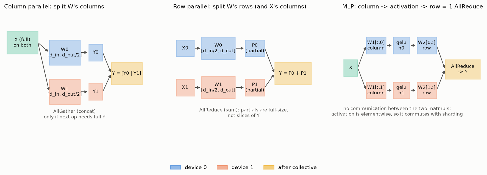
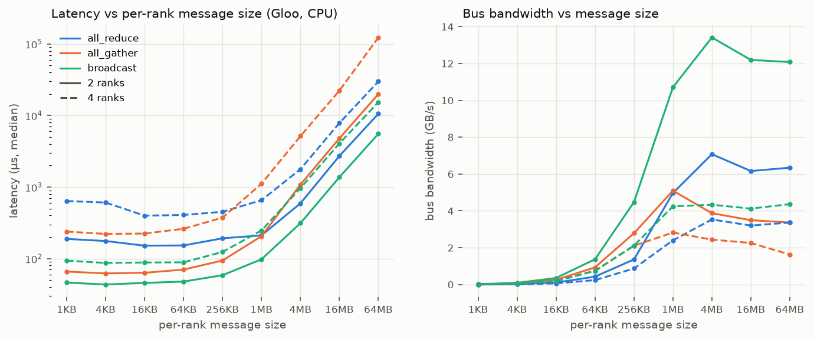
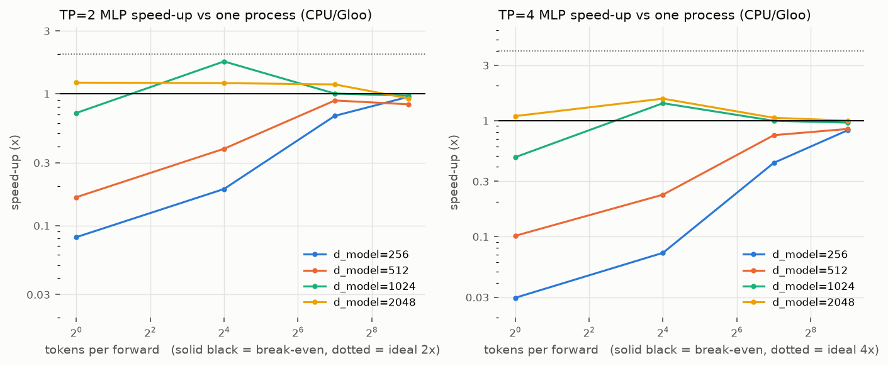
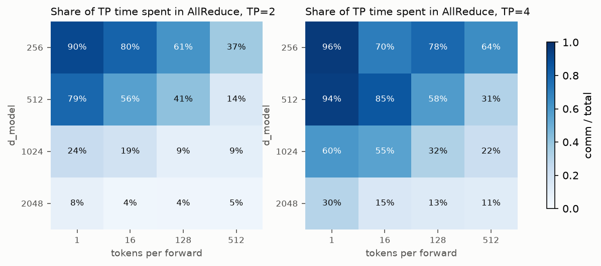
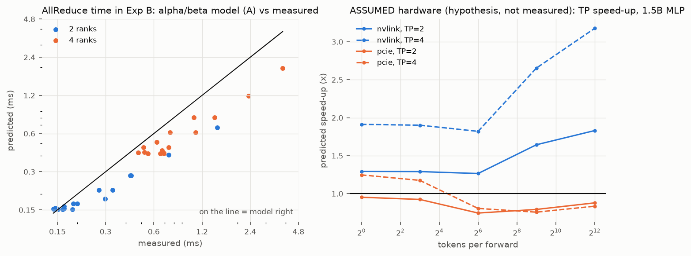

# Tensor parallelism, data parallelism, and what communication costs

> **What the numbers here are.** Sections 1, 2, 4 and 5 are explanation. Section 3 reports
> **real measurements, but on CPU with the Gloo backend**: 2–4 processes on one Apple M4
> (4 performance + 6 efficiency cores), one thread per process, talking over loopback
> sockets, median of 3 repeats. There is **no NCCL, NVLink or PCIe in any measurement**. Rows
> built from assumed GPU numbers are labelled *assumption* and are hypotheses. The two-GPU vLLM
> experiment has **not been run** ([RUNBOOK.md](RUNBOOK.md)).

## 1. How tensor-parallel matrix multiplication works



A linear layer computes `Y = X · W` with `X: [tokens, d_in]`, `W: [d_in, d_out]`. Tensor
parallelism cuts `W` across `n` devices so that each holds `1/n` of the weights and does `1/n`
of the multiply-adds. There are exactly two ways to cut a matrix:

| | **Column parallel** | **Row parallel** |
|---|---|---|
| Cut | `W = [W₀ \| W₁]` (columns / output features) | `W = [W₀; W₁]` (rows / input features) |
| Input each device needs | all of `X` | its slice `Xᵢ` of `X`'s columns |
| Local result | `Yᵢ = X·Wᵢ` — a **slice of Y** | `Pᵢ = Xᵢ·Wᵢ` — a **full-size partial sum** |
| Assemble | **concatenate** → AllGather (or skip it) | **add** → AllReduce |
| Bias | split like the columns | added once, after the reduce |

Both are verified in `tests/test_tensor_parallel.py`: concatenating column partials, or summing
row partials, reproduces `X·W` (max error ~1e-6, fp32), and a test pins down that concatenating
row partials is *wrong* (wrong shape — they are not slices).

**Why one AllReduce per MLP.** A transformer MLP is `down(act(up(x)))`. Make `up` column-parallel
**without gathering**: each device keeps its slice `hᵢ` of the hidden activation. `act` is
elementwise, so it works on slices unchanged. `down` is row-parallel and wants exactly that
slice as its input. So the whole MLP needs **one AllReduce on the output**, of size
`tokens × d_model` — not on the (4× larger) hidden activation. Attention is the same: split
heads across devices (column-parallel QKV), attend locally, row-parallel output projection,
one AllReduce. That is why a transformer layer costs **two AllReduces** in the forward pass,
and how vLLM does it ([TP_SOURCE_NOTES.md](TP_SOURCE_NOTES.md)).

**When AllGather vs AllReduce is needed** (the Session 3 question): AllGather when a
column-parallel output must be a *complete* tensor (e.g. the final logits/vocab projection, or
when the next op mixes across the sharded dimension); AllReduce after a row-parallel layer,
always. Column → elementwise → row needs neither between the two matmuls.

**Why it needs communication at all.** After a row-parallel layer each device holds only a
*partial* sum; no device has the answer. The sum over devices *is* the computation. This cost
is paid on the critical path of every layer of every token.

## 2. Data parallelism vs tensor parallelism

| | **Data parallel (DP)** | **Tensor parallel (TP)** |
|---|---|---|
| What is split | the *batch* (requests); every device holds a **full copy** of the model | each *weight matrix*; every device holds `1/n` of the model |
| Model must fit on | one device | `1/n` of it per device |
| Memory per device | full weights + its own KV cache | `1/n` of weights → more room for KV cache |
| Communication, inference | **none** (replicas are independent) | `2 × layers` AllReduces **per forward pass** |
| Communication, training | one gradient AllReduce per step | the same activation AllReduces, forward *and* backward |
| Message size | gradients ≈ model size (big, once per step, overlappable) | `tokens × d_model` (small at decode, on the critical path) |
| Helps | **throughput** (more requests/s) | **fit** and per-request **latency** of a big model |
| Fails when | the model doesn't fit one device | the interconnect is slow or the model/batch is small |
| Scales to | as many replicas as you have | the NVLink island, typically ≤ 8 GPUs; divides head count |

They compose: 8 GPUs can run 4 replicas of a TP=2 model (DP×TP). For a model that fits on one
GPU, *two independent TP=1 servers* is the baseline TP=2 has to beat ([RUNBOOK §4](RUNBOOK.md)).

## 3. Communication benchmark (CPU / Gloo, measured)

`run_experiments.py`; raw rows in `results/exp_a.json`, `exp_b.json`, `exp_c.json`, log in
`results/run_log.txt`. "Bus bandwidth" follows the nccl-tests convention (AllReduce ×2(n−1)/n,
AllGather ×(n−1)/n of the total gathered size). Collective timings are the **bare**
`torch.distributed` calls on preallocated buffers. (An earlier run timed my wrapper functions,
which clone/concatenate on every call; at 16 MB that made AllReduce look 2.5× slower, so it was
redone.) Each timed call starts right after a barrier, so latencies **include barrier-exit skew
between ranks**, and per-case results take the slowest rank's median. There is no CPU affinity
on macOS and this chip has 4 performance + 6 efficiency cores, so 4-rank runs may mix core types.

### A. Collectives vs message size



Latency µs (bus bandwidth GB/s), per-rank message size:

| ranks | collective | 1 KB | 64 KB | 1 MB | 16 MB | 64 MB |
|---|---|---|---|---|---|---|
| 2 | all_reduce | 189 (0.01) | 153 (0.43) | 211 (5.0) | 2,722 (6.2) | 10,577 (6.3) |
| 2 | all_gather | 66 (0.02) | 70 (0.93) | 206 (5.1) | 4,801 (3.5) | 19,921 (3.4) |
| 2 | broadcast | 46 (0.02) | 48 (1.4) | 98 (10.7) | 1,376 (12.2) | 5,555 (12.1) |
| 4 | all_reduce | 638 (0.00) | 407 (0.24) | 655 (2.4) | 7,856 (3.2) | 29,902 (3.4) |
| 4 | all_gather | 239 (0.01) | 261 (0.75) | 1,114 (2.8) | 22,299 (2.3) | 123,285 (1.6) |
| 4 | broadcast | 93 (0.01) | 89 (0.74) | 247 (4.2) | 4,070 (4.1) | 15,374 (4.4) |

What it shows:

- **Two regimes.** Up to ~64 KB latency is **flat** (a 1 KB AllReduce costs about what a 64 KB
  one does: ~150–190 µs on 2 ranks, ~400–640 µs on 4). That floor is the latency term α, the
  per-message software and socket overhead. Above ~1 MB latency grows linearly with size: the
  bandwidth term β. Bandwidth only approaches its ceiling at ≥ 4 MB.
- **Fitted α/β** (`results/exp_a_fits.json`, weighted least squares on relative error):
  2-rank AllReduce α ≈ 151 µs, β ≈ 0.123 ns/byte (≈ 8 GB/s); 4-rank α ≈ 417 µs,
  β ≈ 0.368 ns/byte (≈ 2.7 GB/s). **These fits are rough: the worst point is off by 19–41%**
  (the curve bends at cache-size boundaries), so treat α and β as ±40%. The fitted β
  (≈ 8 GB/s) is above the highest measured 2-rank AllReduce bus bandwidth (6.3 GB/s) because the
  line is fitted through all sizes, not just the largest.
- **More ranks is worse, not free.** From 2 to 4 ranks, 1 KB AllReduce latency rises 189 → 638 µs
  and 64 MB bus bandwidth falls 6.3 → 3.4 GB/s. On CPU all ranks share one memory system, which
  probably overstates this relative to GPUs; the direction (more participants, more steps, more α)
  is general.
- **AllGather is not simply a cheaper AllReduce here:** at 64 MB on 4 ranks it takes 123 ms vs
  30 ms, because each rank receives `n×` its shard (256 MB) rather than 64 MB.
- **Run-to-run noise:** the median relative spread across the 3 repeats is 10%, but the worst case
  is 183% (a single outlier among the 54 cases), so a single cell of `exp_a.json` should not be
  over-read; the fits use all points.

### B. A tensor-parallel MLP against one process




`ParallelMLP` (column → GELU → row, one AllReduce) vs the unsharded MLP, `d_ff = 4·d_model`.
The baseline is timed on rank 0 **alone** (others idle), as a TP=1 server would run. Selected rows
(ms; full grid in `results/exp_b.json`):

| ranks | d_model | tokens | one process | TP total | of which AllReduce | speed-up | comm share |
|---|---|---|---|---|---|---|---|
| 2 | 256 | 1 | 0.017 | 0.206 | 0.186 | **0.08×** | 90% |
| 2 | 512 | 16 | 0.099 | 0.258 | 0.145 | 0.38× | 56% |
| 2 | 1024 | 16 | 1.495 | 0.849 | 0.165 | 1.76× (see below) | 19% |
| 2 | 2048 | 1 | 2.129 | 1.751 | 0.141 | 1.22× | 8% |
| 2 | 2048 | 512 | 29.8 | 32.4 | 1.495 | 0.92× | 5% |
| 4 | 256 | 1 | 0.020 | 0.687 | 0.658 | **0.03×** | 96% |
| 4 | 1024 | 16 | 1.733 | 1.223 | 0.676 | 1.42× | 55% |
| 4 | 2048 | 512 | 33.6 | 33.5 | 3.825 | 1.00× | 11% |

- **The AllReduce is a fixed toll.** 0.14–1.5 ms on 2 ranks regardless of how little compute there
  is. When the whole MLP takes 0.017 ms, a 0.19 ms toll makes TP **12× slower**; with 4 ranks,
  **33× slower**. TP beat one process (>1.05×) in only **4 of 16** shapes on 2 ranks (best 1.76×)
  and **4 of 16** on 4 ranks (best 1.55×).
- **Small work + collective = loss.** Every shape with `d_model ≤ 512` and `tokens ≤ 16` spent
  56–96% of its time in communication. This is the decode regime of a small model.
- **Compute did not scale on this machine, and this limits what Exp B can show.** With the
  AllReduce removed, 2 processes sped the compute up only 1.07–1.26× on the large shapes
  (`d_model=2048, tokens ≥ 128`), and 4 processes 1.23–1.38×, rather than 2× and 4×. So the
  large-shape speed-ups of ≈1.0× say "this Mac cannot parallelise the matmul across processes",
  **not** "TP is useless". My (untested) guess is that the processes share matrix-multiply hardware
  / memory bandwidth, and 4-rank runs may also mix performance and efficiency cores. On GPUs each
  device brings its own compute and HBM, so compute does scale; this CPU benchmark is a reliable
  measurement of the **communication** side only.
- **Treat the best speed-ups as artifacts.** The "1.76×" row is not parallelism: its single-process
  baseline (1.495 ms at 16 tokens) is 3× the 1-token time and half the 128-token time (3.0 ms),
  which points to single-thread kernel selection / cache behaviour on the full-size shapes.
  Several small shapes also show super-linear compute speed-ups (up to 2.3× on 2 ranks, 3.5× on 4),
  plausibly the half-size weight shard fitting in cache (untested). Baseline spread across the
  repeats reaches 62% (2 ranks) and 218% (4 ranks), so small differences in
  `results/exp_b.json` are not meaningful. The effects that are robust are the large ones: the
  fixed toll and the 12–33× slowdowns at tiny shapes.
- **Comm share is a rough number.** The isolated AllReduce (`tp_comm_s`) is a max-over-ranks of
  per-rank medians on a zero buffer, while the total is timed inside the MLP; they are different
  statistics, and an earlier run of the same benchmark printed a 113% share for one cell. That
  cell did not reappear in the final run (maximum share 96%), but shares near 100% mean
  "communication dominates", not a precise fraction.

### C. Does the α/β model predict B's communication time?



Left panel: using only Exp A's fitted α and β and the message size `tokens × d_model × 4`
bytes, predict the AllReduce time Exp B measured. **31 of 32 cases are within 0.5–2×** of the
measurement (median ratio 0.76, range 0.45–1.08); 14 of 32 are within ±25%. The model tends to
**under-predict** large messages (ratio 0.45–0.81 at 512 tokens), because the real curve bends
away from a straight line. Building the speed-up from the *measured* compute time plus the
predicted communication time lands within 19% (median) of the measured speed-up, worst 60%. So a
two-parameter latency + bandwidth model is a **usable first estimate**, good to roughly ±40%.

Right panel — **assumptions, not measurements**: one MLP of a Qwen2.5-1.5B-sized model (d_model
1536, d_ff 8960, SwiGLU = 3 matrices, fp16; dims from memory of the model card — verify) with
assumed round numbers: 200 TFLOP/s, 1.5 TB/s HBM, AllReduce α = 15 µs / 200 GB/s bus bandwidth
("NVLink-class") or α = 30 µs / 12 GB/s ("PCIe-class"). Compute is the roofline
`max(FLOPs/F, weight bytes/BW)` — **decode is memory-bound**, so TP helps by halving the weight
bytes each GPU reads. The model says, for the MLP alone, TP=2: 1.29× at 1 token and 1.83× at 4096
tokens on the NVLink-class link; 0.95× and 0.88× on the PCIe-class link. Every term is a guess,
and these rows are the hypotheses [RUNBOOK §5](RUNBOOK.md) is designed to confirm or refute.

### The break-even rule these results support

TP over `n` devices beats one device **iff** the compute it saves exceeds the communication it adds:

```
T_single · (1 − 1/n)  >  α + β · (tokens · d_model · bytes)        (one AllReduce per MLP)
```

Small `T_single` (small model, few tokens) or large α, β (slow link) → TP loses. This is the
relationship behind every row above.

## 4. GPU topology and why it controls performance

*Conceptual; no GPU was available, so nothing here was measured. Bandwidth figures are
approximate vendor-spec orders of magnitude from memory — check your hardware.*

A collective is only as fast as the slowest link it must cross, and links differ by ~10×–100×:

| Link | Typical order of magnitude (per GPU) | Latency | Note |
|---|---|---|---|
| NVLink / NVSwitch | hundreds of GB/s (≈ 300–900 GB/s aggregate on A100/H100 class) | ~µs | all-to-all inside a node with NVSwitch |
| PCIe Gen4/5 x16 | ≈ 25–60 GB/s | higher; goes via host bridge | shared; GPU↔GPU may cross the CPU |
| Cross-socket (SYS in `nvidia-smi topo -m`) | below PCIe | highest on-node | traffic crosses the inter-CPU link |
| Network (InfiniBand/RoCE/Ethernet) | ≈ 12–50 GB/s per NIC | tens of µs | between nodes |

How to see yours: `nvidia-smi topo -m` prints a matrix: `NV#` = # NVLinks between the pair,
`PIX`/`PXB` = same PCIe switch, `PHB` = through the host bridge, `NODE`/`SYS` = across NUMA /
sockets. `NCCL_DEBUG=INFO` shows which rings/trees and transports NCCL chose.

Consequences for parallelism:

- **TP stays inside the fastest island** (one NVLink domain). It puts a latency-sensitive
  AllReduce on the critical path of every layer, which cannot hide behind slow links. TP across
  nodes over Ethernet is almost never worth it.
- **Pipeline and data parallelism tolerate slow links.** PP sends one activation tensor per
  stage boundary per micro-batch, and DP inference needs no communication at all — so they are
  what you stretch across nodes.
- **Which GPUs form a TP group matters.** On a PCIe box where only some pairs are NVLinked,
  pick a TP group from NVLinked GPUs. vLLM builds TP groups from adjacent ranks
  ([TP_SOURCE_NOTES §3](TP_SOURCE_NOTES.md)), so `CUDA_VISIBLE_DEVICES` ordering decides the pairing.
- **Group size changes the algorithm and the cost.** Larger groups mean more ring steps (my CPU
  data shows 2→4 ranks raising small-message latency ~3×). NCCL picks a ring or tree algorithm
  and a latency- or bandwidth-oriented protocol per message size; low-latency protocols exist
  precisely because TP messages at decode are small and latency-bound — the α regime of Exp A.

## 5. Decision guide

1. **Does the model (weights + a useful KV cache) fit on one GPU?**
   Yes → start at **TP=1**. To use more GPUs, run **replicas (DP)**: no communication, linear
   throughput. Only move to TP if you measure a latency win that matters.
2. **No (weights don't fit, or the KV cache is too small for your batch/context)?** →
   **TP inside one node**, smallest degree that fits. TP degree should divide the attention
   (and KV) head count and stay within one NVLink island.
3. **Doesn't fit in one node?** → **TP within the node × pipeline parallel across nodes**
   (PP crosses the slow link only at stage boundaries).
4. **PCIe-only GPUs?** Prefer fewer TP ways (2) or replicas/PP; run `nccl-tests` first and plug
   α, β into the break-even rule.
5. **Small model, small batches (decode-dominated)?** The AllReduce toll is largest relative
   to the work. Expect TP to *hurt* unless the link is NVLink-class — my CPU measurements show
   the extreme version (0.03–0.4× at small shapes).
6. **Large prefill / large batch?** More compute per AllReduce → TP's communication share
   shrinks (5–13% at the largest shapes here) and TP pays off *if compute really parallelises*.
7. **MoE models** add expert parallelism (all-to-all) — outside this lab.

Always **measure** the exact config ([RUNBOOK.md](RUNBOOK.md)); the break-even rule is a
first estimate (±40% here), not a substitute.
