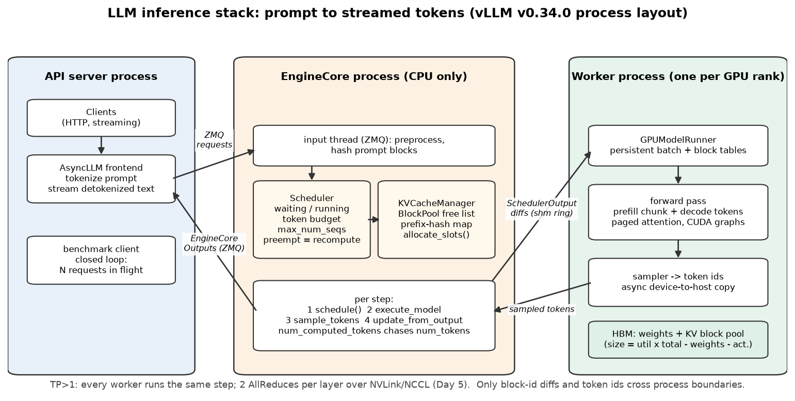
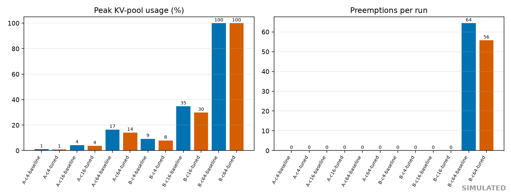
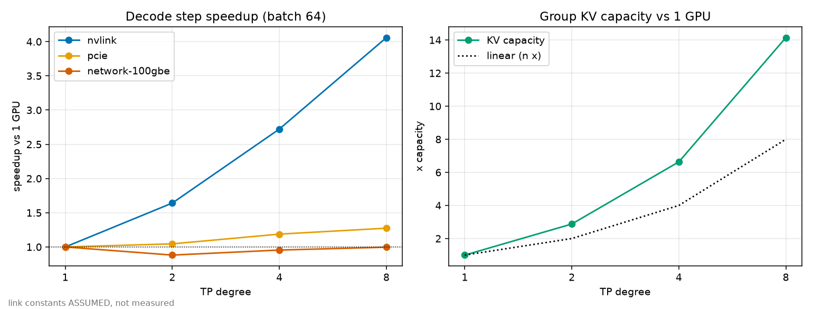
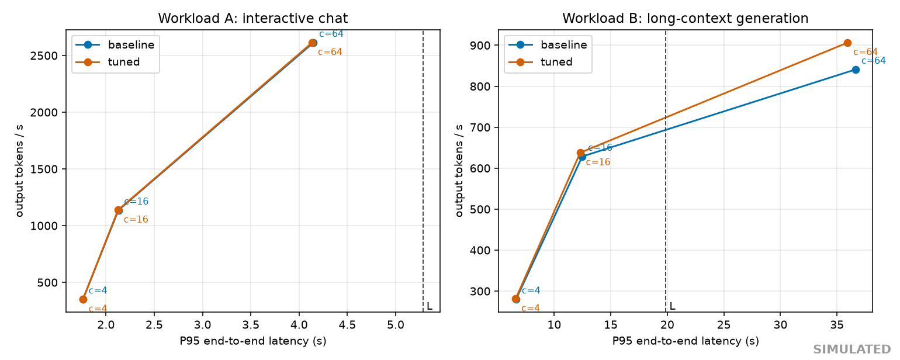
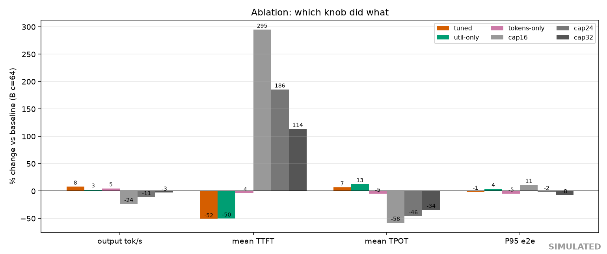

# Day 7 final engineering assessment: serving an 8B model, from KV bytes to a latency-bounded throughput decision

> **Read this first.** Every benchmark number below is **SIMULATED**: the Day 3 scheduler/engine with a roofline cost model derived
> from *illustrative* A100-40GB peaks. No GPU ran anything in this repo (it was built on a Mac). Claims are tagged:
> **[measured-Mac]** Apple M4/MPS, Day 1 engine, Day 6 · **[source]** read from vLLM v0.34.0 source, Day 4 · **[mechanism]** derived arithmetic ·
> **[SIM]** simulated here · **[assumed]** assumed constant · **[GPU pending]** needs the run in [RUNBOOK.md](RUNBOOK.md).
> Peak GPU memory is *not measured*. Tables: [results/sim/tables.generated.md](results/sim/tables.generated.md); raw rows: `results/sim/*.json`.

**Result in four lines.** (1) Under the objective fixed before the runs, **no configuration change is warranted**: `tuned` is within noise at
every cell that meets the latency limit. (2) The only cell where the config matters is long-context at concurrency 64, which is **KV-capacity
bound** (100% pool use, ~60 preemptions) and **misses the latency limit under both configs**. (3) The latency limit is met only by running
long-context at concurrency 16, **giving up 25-30% of the throughput available at 64**. (4) The lever that moves that frontier is KV capacity,
which a second GPU more than doubles, **if** the link is NVLink-class. All of this is a hypothesis until a GPU run.

---

## 1. Inference architecture



Pipeline, prompt to streamed tokens **[source: Day 4 SOURCE_TRACE §0-1]**:

1. **API server process.** The request arrives over HTTP, the prompt is tokenized, and the request is sent over ZMQ to the engine core.
2. **EngineCore process (CPU only).** An input thread preprocesses the request and hashes its prompt blocks. The busy-loop thread runs the
   `Scheduler` (waiting/running queues, token budget, `max_num_seqs`) and the `KVCacheManager` (block pool, prefix-hash map). Each step:
   `schedule()` -> `execute_model` -> `sample_tokens` -> `update_from_output`.
3. **Worker process per GPU rank.** `GPUModelRunner` keeps a persistent batch and block tables, builds inputs, runs the forward pass (prefill
   chunks and decode tokens in one batch, paged attention, CUDA graphs) and samples. Only block-id diffs go in and token ids come out.
4. **Streaming.** Tokens return to the frontend over ZMQ, are detokenized and streamed. TTFT ends at the first token; TPOT is the mean gap after it.

The scheduler is pure CPU bookkeeping; the worker owns the actual KV tensors in HBM. With TP > 1 every worker runs the same step and
AllReduces twice per layer (section 5).

## 2. KV-cache memory calculations

**Per token (GQA)** **[mechanism, Day 2 `memory_calculator.py`]**

```
kv_bytes/token = 2 (K,V) x layers x kv_heads x head_dim x dtype_bytes
Llama-3-8B fp16 = 2 x 32 x 8 x 128 x 2 B = 131,072 B = 128 KiB / token
```

With full multi-head attention (32 KV heads) it would be 512 KiB/token, so **GQA gives 4x** more resident tokens for the same memory.

**Pool size on the assumed GPU** (A100-40GB = 40 GiB; weights 16.06 GB = 14.96 GiB; activation/context reserve 2 GiB, **[assumed]**)

```
pool_bytes  = 40 GiB x util - 14.96 GiB - 2 GiB
util 0.85:  17.04 GiB -> 139,600 tokens (8,725 blocks of 16)      <- baseline
util 0.92:  19.84 GiB -> 162,544 tokens (10,159 blocks)           <- tuned (+16%)
```

(Without GQA the 0.85 pool would hold only ~34,900 tokens.) vLLM sizes its pool the same way, from the worker's memory profile
**[source: Day 4 CHECKPOINT Q3]**; here it is arithmetic on assumed numbers.

**Demand per case** (time-averaged footprint of a sequence = prompt + half its output; `kv_sizing.capacity_pressure`):

| Case | Mean tokens/seq | Concurrency | Demand (tokens) | Demand / pool (0.85) | Demand / pool (0.92) |
|---|---|---|---|---|---|
| A | 320 | 64 | 20,480 | 0.15 | 0.13 |
| B | 2,752 | 16 | 44,032 | 0.32 | 0.27 |
| B | 2,752 | **64** | **176,128** | **1.26** | **1.08** |

Only B at concurrency 64 exceeds the pool, so it is the only case predicted to preempt. A maximal B sequence (3,200 in + 480 out) holds
3,680 tokens = 460 MiB. **The simulator independently agrees:** across all 12 cases, preemptions occur exactly in the two B@64 cases
(`tests/test_closed_loop_sim.py::test_pressure_prediction_matches_simulated_preemption`). Day 2's paged allocator is what makes this
arithmetic honest: it wastes 1-16% of reserved memory versus 83% for contiguous allocation (Day 2 Exp C, simulated).

## 3. Scheduler design and behavior

**Design** (Day 3 simulator; vLLM comparison in Day 4 `COMPARISON.md`). Each iteration is one forward pass over a token budget. Every decoding
sequence costs one token; leftover budget goes to prefill chunks (chunked prefill on, as in vLLM v1). Waiting requests are admitted in FCFS
order while a slot, KV blocks and budget exist, with strict head-of-line blocking. When a running sequence needs a block and the pool is
empty, the **lowest-ranked running request is preempted by recompute**: its blocks are freed, progress reset, and it re-queues. Iteration time is
`overhead + max(compute, memory)` with `memory = weight_read + KV read`, so a small decode batch is bandwidth-bound and a large prefill is
compute-bound **[mechanism]**. In this report the cost-model constants come from bytes and bandwidth (`kv_sizing.cost_model_for`): weight read
10.3 ms, 0.103 ms/token of compute, so a 2,560-token prompt costs ~264 ms of compute against a 10.3 ms decode step **[assumed hardware]**.

**What vLLM does the same / differently** **[source]**: no separate prefill and decode phases (`num_computed_tokens` chases
`num_tokens_with_spec`); running requests are served first, then waiting ones, and a step that preempted admits none; a waiting request that
cannot get blocks stops the admission loop and **never evicts a running one**. Day 3 reserves a request's KV on-demand, whereas vLLM also checks
that the whole prompt fits at admission (`scheduler_reserve_full_isl`) but allocates only the first chunk: **not modelled here**.

**Observed behavior on the matrix [SIM]** (full table in `tables.generated.md`):

| Case | TTFT mean ms | TPOT mean ms | P95 e2e ms | out tok/s | KV peak | preempt | label |
|---|---|---|---|---|---|---|---|
| A c=4 baseline | 30 | 11.1 | 1,761 | 351 | 1% | 0 | bandwidth-bound decode |
| A c=64 baseline | 202 | 22.1 | 4,149 | 2,614 | 17% | 0 | compute / prefill interference |
| B c=16 baseline | 571 | 23.2 | 12,476 | 629 | 35% | 0 | compute / prefill interference |
| B c=64 baseline | 6,964 | 56.5 | 36,653 | 841 | 100% | 64 | **KV-capacity bound** |
| B c=64 tuned | 3,424 | 60.5 | 35,942 | 907 | 100% | 56 | **KV-capacity bound** |

Reading it: A scales almost for free (c=4 -> 64 gives 7.4x tokens/s for 2.4x P95 and 2x TPOT). B at 64 does not: the pool is full, ~64
sequences are preempted and recomputed, and TTFT balloons to seconds because new requests wait for blocks. Day 3's chunked-prefill finding
(worst token gap 118 -> 21 ms, Day 3 README) is the mechanism behind `tuned`'s smaller token budget **[SIM, Day 3]**.



## 4. vLLM internal execution trace

Full annotated call flow with `file:line` for 151 machine-checked symbols is in [Day 4 SOURCE_TRACE.md](../day4-vllm-internals/SOURCE_TRACE.md)
(`verify_trace.py` resolves them against the pinned source). One decode step in steady state **[source: v0.34.0 @ `62d4bc3`]**:

```
EngineCoreProc.run_busy_loop (ENG:1794)
 +- Scheduler.schedule (SCH:716)            RUNNING loop first: num_new_tokens = num_tokens_with_spec - num_computed_tokens
 |    +- KVCacheManager.allocate_slots (KVM:401)  -> None when blocks are short
 |    +- None? preempt victim running[-1] (FCFS) / max(priority, arrival)   (_preempt_request SCH:1853), retry
 |    +- WAITING loop, skipped if anything was preempted; admit only if allocate_slots succeeds
 +- Executor.execute_model (MPX:430) --shm ring--> Worker.execute_model (GW:1449) -> GPUModelRunner.execute_model (GMR:1826)
 +- Executor.sample_tokens (MPX:443) -> GPUModelRunner.sample_tokens (GMR:2216)   (async device->host copy)
 +- Scheduler.update_from_output (SCH:2301): append tokens, check stop, free blocks of finished requests (BlockPool.free_blocks BP:798)
```

Why this matters for the numbers above: (a) `schedule()` charges token budget and KV blocks **together**, per request, per step, so a smaller
`max_num_batched_tokens` and a larger pool act on different constraints; (b) preemption is *only* for running requests, so the B@64 thrash
is requests evicting each other, not the queue backing up; (c) `max_num_batched_tokens` also shrinks the pool slightly (the startup profile run
sizes activations at that value), a second-order effect the simulator ignores. The brief's file list was stale (`gpu_model_runner.py` no longer
exists); the source, not the brief, is the authority (Day 4).

## 5. Multi-GPU communication

**Tensor parallelism** shards each layer's matrices: column-parallel QKV and gate/up, row-parallel output and down projections, so each
layer needs **two AllReduces** (after attention's out-projection and after the MLP) **[source: Day 5 TP_SOURCE_NOTES]**. Per decode step with
`T` sequences in the batch, `L` layers, hidden size `h`, TP degree `n` **[mechanism; multi_gpu.py]**:

```
compute = max(2 x params x T / F, weight_bytes / BW) / n          decode: the weight read wins
comm    = 2L x alpha + [2(n-1)/n / busbw] x 2L x T x h x 2 B       ring AllReduce, fp16 activations
```

For Llama-3-8B, T = 64: 64 AllReduces of 512 KiB each. Results on the **assumed** link constants (NVLink-class 200 GB/s bus, 15 us; PCIe-class
12 GB/s, 30 us; 100 GbE 10 GB/s, 50 us) **[assumed; results/sim/multi_gpu.json]**:

| Link | TP | Step ms | Speedup vs 1 GPU | Comm share | Group KV tokens | KV vs 1 GPU |
|---|---|---|---|---|---|---|
| (1 GPU) | 1 | 10.33 | 1.00 | 0% | 139,600 | 1.00x |
| NVLink | 2 | 6.29 | **1.64** | 18% | 401,744 | **2.88x** |
| NVLink | 4 | 3.79 | 2.72 | 32% | 926,032 | 6.63x |
| PCIe | 2 | 9.88 | 1.05 | 48% | 401,744 | 2.88x |
| 100 GbE | 2 | 11.72 | **0.88** | 56% | 401,744 | 2.88x |

**Two effects, and the second matters more here.** *Speed*: decode is weight-read bound, so TP halves the read but adds 64 latency-bound
collectives; the gain depends entirely on the link. *Capacity*: weights are sharded, so each GPU frees `weight_bytes (1 - 1/n)` for KV, and KV
heads shard too (8 heads divide by 2/4/8), so group KV grows **faster than n** (2.88x at TP=2). B@64 needs ~176k tokens: it does not fit on
one GPU (139.6k) and fits on two (401.7k), so the preemption thrash in section 3 should disappear. Day 5 measured only Gloo/CPU AllReduce
(alpha ~151 us on 2 ranks, ~417 us on 4), so the NVLink/NCCL constants are untested.



**What changes for two GPUs / multi nodes:**

- **Two GPUs, one node:** add `--tensor-parallel-size 2`; require NVLink (or at least a fast PCIe switch) or the step speedup vanishes (1.05x). KV headroom,
  not speed, is the win for long context; re-derive `max_num_batched_tokens` and the pool from the new per-GPU memory. A cheaper alternative if
  the model fits: **data parallel** (two replicas behind a router) doubles request throughput with zero communication but does *not* raise per-replica KV capacity.
- **Multi-node:** do not TP across nodes (0.88x above: the 2L small collectives per step are latency-bound on Ethernet). Keep TP inside a node, use
  **pipeline parallelism** across nodes (one activation transfer per stage boundary, at the cost of bubble and PP-depth latency), and replicate with
  DP for throughput. Every added hop also adds a failure domain and an operational cost the matrix does not measure.
- **Measurement changes:** the matrix needs a TP axis and `nvidia-smi topo -m` per run; peak memory becomes per-rank; the A/A noise floor must be re-measured because
  collectives add jitter. None of this is automated yet (README limitations).

## 6. Benchmark methodology

- **Workloads** (`matrix.py`): A chat ~256 in / ~128 out; B long-context ~2560 in / ~384 out; lengths ~U[len(1-r), len(1+r)], r = 0.25, so the longest
  sequence (3,680 tokens) fits `max_model_len` 4096. `--ignore-eos` so output length is fixed by the workload, not the model.
- **Load:** closed loop, `--max-concurrency` 4 / 16 / 64 with `--request-rate inf`; `num_prompts = max(100, 8 x concurrency)`; warmups = concurrency. Closed loop means
  the offered load adapts to the server, which is why P95 rises with concurrency instead of the queue growing without bound.
- **Configs:** `baseline` = Day 4 baseline (util 0.85, 8192 batched tokens); `tuned` = (0.92, 2048). `max_num_seqs` is 256 in both and cannot bind at concurrency <= 64.
  `tuned` changes two knobs at once, so a sim-only **ablation** toggles each alone, and adds admission caps (`max_num_seqs` 16/24/32).
- **Repeats and stability:** 3 repeats per case, 5 for concurrency 64, plus an **A/A control** (B@16 baseline repeated with fresh prompts). A difference is "real" only if
  repeat ranges do not overlap *and* it exceeds the noise floor (the larger of the A/A delta and each case's CV); one repeat never establishes a difference
  (`stability.py`). On the GPU the runner starts a fresh server per run and rotates case order each round, the position-bias fix from Day 6.
- **Metrics:** TTFT, TPOT, P95 e2e, request and output-token throughput, peak GPU memory *(not measured here)*, peak KV-pool use, preemptions, peak waiting queue.
- **Fixed in advance:** the workloads, `tuned`, the objective, and the latency-limit factor `k = 3.0` were written down before any run
  (README, `matrix.py`, `objective.py`); the GPU predictions H1-H6 in the RUNBOOK were written from the simulator before any GPU data exists.

**Noise observed [SIM]:** throughput CV is 0.3-1.2% per case; the matrix-wide throughput noise floor is **1.05%**, P95 e2e **3.0%**, mean TTFT **5.3%**.
Unstable (CV > 5%): P95 TTFT at c=4, B@16 baseline TTFT, and **preemption counts at B@64** (so "64 vs 56 preemptions" is *not* a real difference).
Nine cases (concurrency 4 and 16, including the A/A control) have per-run P95 over fewer than 200 requests, a soft tail estimate. The simulator is deterministic given its seed, so this noise is
prompt-sampling noise only; **real-hardware noise (thermal, clocks, scheduling jitter) is absent** and will be larger **[GPU pending]**.

**Threats to validity.** The noise floor is a single A/A draw (B@16 baseline, 5 repeats) widened by each case's CV, so with 3-5 repeats "real" verdicts near the floor are suggestive and "within noise" means "not shown", not "equal". Simulated hardware; no attention-quadratic cost or prefix cache; idealized closed-loop client; `k` is a judgment; one model; whole-GPU memory
from `nvidia-smi` will mostly reflect `gpu_memory_utilization`, so "peak memory" will say little beyond that setting.

## 7. Profiling evidence

What exists, and what does not:

| Evidence | Source | Status |
|---|---|---|
| Decode is device-bound on weight reads: matmuls 74% of a 15.9 ms step (51-93 GB/s effective); CPU enqueues a step in 3.0 ms | Day 6, Qwen2.5-0.5B fp16 on M4 MPS (`git show day6-profiling:day6-profiling/performance-report.md`) | **[measured-Mac]**; unified-memory Apple GPU, does not transfer to NVIDIA |
| Batch 1 -> 8 raises throughput only 2.8-3.5x (decode batches ~5.6-6.1x, prefill is compute-bound and does not amortize) | Day 6 E1 | **[measured-Mac]** |
| Removing per-step host syncs: +6.6% throughput, -7% median TPOT, A/A control -0.1% | Day 6 O1 | **[measured-Mac]** |
| `eager` attention 33% slower than `sdpa` at decode | Day 6 O2 | **[measured-Mac]** |
| Bottleneck labels per case (rule-based: KV-full+preempt, batch at cap, TPOT vs weight-read floor) | `bottleneck.py` on `results/sim` | **[SIM]** |
| nsys timelines, vLLM profiler, GPU peak memory | none | **not measured** |

The measured Mac findings and the simulated labels agree in kind: decode at low concurrency sits near the weight-read floor (TPOT 11.1 ms against a 10.3 ms floor at A c=4;
within the 1.5x rule), and the step stretches once prefill shares it (B c=16: 23.2 ms, 2.2x the floor). That agreement is by construction of the cost model, not independent
validation. **No claim here has GPU profiling evidence.** The first GPU run should add an `nsys` trace of B@64 to confirm the KV-bound story (GPU idle gaps during recompute, not
kernel saturation); Day 6's `gpu/run_nsys.sh` on its branch is the starting point.

**How I'd identify the dominant bottleneck** (answers Q9): check KV-pool use and preemptions first; then batch size against `max_num_seqs`; then TPOT against the weight-read floor
(`weights / HBM bandwidth`); then where wall time goes (GPU timeline gaps, CPU enqueue vs step time as in Day 6's launch probe).

## 8. Final optimization decision

**Objective (fixed before the runs):** maximize output tokens/s subject to P95 end-to-end <= `L`, with `L = 3.0 x` the baseline's P95 at concurrency 4. The unloaded P95 is the hardware's
latency floor for that workload; a multiple of it avoids assuming an arbitrary number is achievable. **A: L = 5,284 ms. B: L = 19,874 ms [SIM].**

**Selection.** For A, all six cells are feasible; the best is A@64 and `tuned` equals baseline on throughput (+0.0%): **keep baseline**. For B, only concurrency 4 and 16 are feasible; the best
is B@16 with `tuned` +1.5% against a 1.1% noise floor, verdict *within noise*: **keep baseline**. **No configuration change is justified by the stated objective.**

**What I changed, why, what happened (B @ c=64, where `tuned` does anything) [SIM]:**



| Metric | Baseline | Tuned | Change | Real? | Direction |
|---|---|---|---|---|---|
| Mean TTFT | 6,964 ms | 3,424 ms | -50.8% | real | improved |
| Output tok/s | 841 | 907 | +7.8% | real | improved |
| Request/s | 2.19 | 2.36 | +7.8% | real | improved |
| Mean TPOT | 56.5 ms | 60.5 ms | +7.1% | real | **regressed** |
| P95 TPOT | 64.9 ms | 69.6 ms | +7.4% | real | **regressed** |
| Peak waiting queue | 60 | 63 | +4.7% | real | regressed |
| P95 e2e | 36,653 ms | 35,942 ms | -1.9% | within noise | unchanged |
| P95 TTFT | 10,881 ms | 10,479 ms | -3.7% | within noise | unchanged |
| Preemptions | 64 | 56 | -13% | within noise (CV > 5%) | unchanged |
| Peak GPU memory | not measured | not measured | | | |

Ablation at B@64 (`results/sim/figures/ablation.png`): `util-only` gives TTFT -50% and tok/s +3% but TPOT **+13%**; `tokens-only` gives tok/s +5%, TPOT -5%, TTFT -4%. `tuned` is roughly the sum.


- *Why I expected it:* a bigger pool means fewer blocks-starved waits (`util`); a smaller token budget stops baseline from packing up to three 2.5k-token prompts into one step, which stalls every
  decoder for ~0.8 s (`tokens`; Day 3's chunked-prefill result).
- *What happened:* the util change did most of the TTFT work and the token-budget change most of the TPOT work, as expected; but `util` also raises TPOT because more sequences decode at once. **I did not
  expect `tuned` to leave P95 e2e unchanged**: the TTFT win is paid back in per-token time over 384 output tokens. These are mechanisms consistent with the simulator, not isolated experiments.
- *Neither config meets `L` at 64* (36.7 s and 35.9 s against 19.9 s).

**Cheaper levers tested and rejected [SIM].** Admission caps at B@64 (`max_num_seqs` 16/24/32) remove preemption (KV use 35-68%) and cut TPOT 34-58%, but TTFT rises 114-295% and tok/s falls 3-24%
(P95 e2e: cap 32 is -7.6%, cap 16 is +11%). In a closed loop, queueing replaces thrash; it does not create capacity.

**Operating-point finding (the real decision).** Meeting `L` for B means running at concurrency 16 (629-638 tok/s, P95 12.3-12.5 s) instead of 64 (841-907 tok/s, P95 ~36 s): **-25% (baseline) to -30% (tuned) throughput to
keep P95 within the limit.** For A, concurrency 64 is both feasible and best. If chat TTFT is the real requirement (outside the stated objective), `tuned` is worth adopting for A: A@64 mean TTFT
-19% and P95 TTFT -33.5% (both real) at +0.0% tok/s and +1.4% TPOT. I am not changing the recommendation on that basis, because the objective was fixed first; it is a different objective.

**What bottleneck remains.** B@64: **KV capacity** (full pool, preemption by recompute). B@16 and A@64: the decode step is 2.2x the weight-read floor because prefill chunks share it, so
**prefill/decode interference**. A at low concurrency: **HBM bandwidth** (weight reads), where nothing but batching or quantization helps. The change that attacks the dominant one for the case that matters is
**more KV capacity**: TP=2 on NVLink (section 5) or fp8 KV cache (halves bytes per token, not modelled). Both are **[GPU pending]**.

**What would change this decision.** A real GPU run in which H1-H6 (RUNBOOK §4) fail, especially H3 (a real `tuned` gain at a feasible cell) or H5 (B@64 meeting `L`); a different `k`; or a latency
objective on TTFT instead of end-to-end.

## 9. The biggest tradeoff

**Throughput bought by batching is paid for in per-request latency, and KV capacity decides how steep the price gets.** Raising concurrency from 16 to 64 on long-context adds +42% output tokens/s
(638 -> 907) but multiplies P95 end-to-end latency by **2.9x** (12.3 -> 35.9 s) and TPOT by **2.6x** (22.9 -> 60.5 ms), because the pool fills and sequences evict one another. The same move on chat is
cheap (7.4x tokens/s for 2.4x P95) because its KV demand is 15% of the pool. Every knob I tried either moved along that curve (admission caps, concurrency) or bought a slice of one latency
metric with another (`tuned`: TTFT -50% for TPOT +7%). Only adding capacity, with more or cheaper KV memory, shifts the curve itself, and that is the one thing this repo has not been able to test on real hardware.
